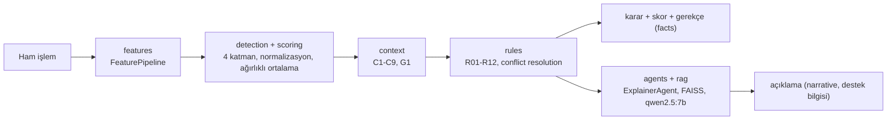

# Fraud & Anomaly Detection Platform

IEEE-CIS Fraud Detection verisi üzerinde etiket kullanmayan (unsupervised) çok katmanlı anomali tespiti,
bağlama duyarlı skor düzeltme, YAML/JSON ile konfigüre edilen kural motoru, yerel LLM ile RAG ve çoklu
agent orkestrasyonu. Tümü FastAPI ile servisleştirilir; LLM ve embedding yalnızca yerel Ollama ile
çalışır (ücretli API yok).

> Geliştirmede Claude Code kullanılmıştır; mimari ve iş kuralı kararları geliştiriciye aittir. Karar kayıtları: docs/decisions.md

- Dört anomali katmanı (column, multivariate/Isolation Forest, entity, temporal), fit kuantil
  normalizasyonu ve ağırlıklı ortalama.
- Context kuralları (C1-C9, G1) skoru çarpımsal olarak düzeltir; kural motoru (R01-R12) block / review /
  allow kararı verir ve gerekçeyi gerçek değerlerle yazar.
- RAG ve agent'lar kararı açıklar; LLM karar vermez, yalnızca "destek bilgisi" üretir.
- Batch (parquet) ve online (API) yolu aynı kodu kullanır. `isFraud` yalnızca değerlendirmede okunur.

Ayrıntılar, metrikler ve tasarım gerekçeleri: [docs/technical_doc.md](docs/technical_doc.md).

## Mimari



Katman yönü: `api -> agents -> (rag, rules, context, scoring, detection) -> features -> data`.
Ortak arayüzler `src/core/interfaces.py`, DI container `src/container.py` (`dependency_injector`),
proje sabitleri `configs/settings.yaml` (referans tarih, %80/%20 zaman bazlı split, seed 42).

## Kurulum

Gereksinimler: Python 3.11, [Ollama](https://ollama.com), yaklaşık 16 GB RAM (tam veri ve `qwen2.5:7b` için).

```bash
python3.11 -m venv .venv
source .venv/bin/activate
make install            # pip install -r requirements.txt
```

`Makefile` `.venv/bin/python` varsa onu kullanır.

### Ollama ve modeller
Ollama'yı kurun (macOS: uygulama veya `brew install ollama`), sonra:

```bash
ollama serve                 # ayrı bir terminalde (Ollama uygulaması açıksa gerekmez)
ollama pull bge-m3           # embedding modeli
ollama pull qwen2.5:7b       # LLM
```

Model adları ve zaman aşımları `configs/rag.yaml` içindedir.

## Veri yerleşimi

Veri repoya eklenmez. Kaggle'daki **IEEE-CIS Fraud Detection** yarışmasından `train_transaction.csv` ve
`train_identity.csv` dosyalarını indirip `data/raw/` altına koyun:

```
data/raw/train_transaction.csv
data/raw/train_identity.csv
```

Kaggle CLI ile (Kaggle hesabı, API token ve yarışma kurallarının kabulü gerekir):

```bash
kaggle competitions download -c ieee-fraud-detection -p data/raw
unzip -j data/raw/ieee-fraud-detection.zip train_transaction.csv train_identity.csv -d data/raw
```

## Çalıştırma (sırasıyla)

API, fit edilmiş modelleri ve FAISS indeksini `artifacts/` altından yükler; istek anında eğitim yapmaz.
Bu yüzden **önce `make pipeline` ve `make rag-index` ile artifact'lar üretilir, sonra API başlatılır.**
Artifact'lar olmadan API eksik çalışır: model artifact'ları yoksa süreç açılır ama skorlayan endpoint'ler
503 döner (`/health` eksikleri gösterir); FAISS indeksi yoksa `/rag/query` 503 döner ve `/explain`
açıklaması şablona düşer.

```bash
# 1) Hızlı deneme (isteğe bağlı): zamana göre ilk 50.000 satır, *_sample / sample/ yollarına yazar
SAMPLE_N=50000 make pipeline

# 2) Tam veri batch hattı: profile -> features -> score -> context -> rules (Adım 1-7)
make pipeline

# 3) RAG bilgi tabanı indeksi (Ollama açık olmalı; pipeline'a dahil değildir)
make rag-index

# 4) API
make api                     # http://127.0.0.1:8000, Swagger: http://127.0.0.1:8000/docs
```

`SAMPLE_N=50000 make pipeline` tek makinede baştan sona 46,6 sn sürdü (`docs/step10.md`). API de aynı
ortam değişkenini okur: `SAMPLE_N=50000 make api` örneklem artifact'larıyla açılır. Örneklem sonuçları
yalnızca duman testidir; raporlanan metrikler tam veriye aittir.

| Hedef | Adım | Ne yapar |
|---|---|---|
| `make profile` | 1-2 | Veriyi yükler, birleştirir, profil ve EDA tablolarını üretir |
| `make features` | 3 | Feature'lar, `artifacts/feature_pipeline.joblib`, entity geçmişi |
| `make score` | 4-5 | Dört anomali katmanı ve normalize birleşik skor |
| `make context` | 6 | Context-aware skor düzeltme |
| `make rules` | 7 | Kural motoru ve karar raporları |
| `make pipeline` | 1-7 | Yukarıdaki beş adım sırayla |
| `make rag-index` | 8 | Bilgi tabanını üretir, chunk'lar, embed eder (`artifacts/rag/`) |
| `make agents-demo` | 9 | Üç holdout işlemiyle agent akışı demosu (`reports/agents/`) |
| `make api` | 10 | FastAPI servisi |

RAG'ı tek başına denemek için:
`python scripts/build_rag_index.py --question "Kart testi hangi koşulda tetiklenir?"` (LLM'siz: `--no-llm`).

## API örnekleri

Örnek gövdeler `examples/requests/` altındadır (holdout'tan, batch kural kararına göre seçilmiş, etiketsiz;
yeniden üretmek için `python -m src.api.examples`).

```bash
# Bağımlılık durumu (artifact'lar, FAISS indeksi, Ollama); her zaman 200
curl -s localhost:8000/health | python -m json.tool

# /score: LLM çağırmaz. Aynı TransactionID ikinci kez gönderilirse aynı sonuç duplicate=true ile döner.
curl -s -X POST localhost:8000/score -H 'Content-Type: application/json' \
     -d @examples/requests/block.json | python -m json.tool

# /explain: facts (koddan, otoriter) + narrative (LLM, "destek bilgisi") + agent trace.
# Toplam süre bütçesi 120 sn (planlayıcı 20 + açıklama 100); süre dolarsa ya da Ollama kapalıysa facts döner, narrative=null.
curl -s -X POST localhost:8000/explain -H 'Content-Type: application/json' \
     -d @examples/requests/explain_review.json | python -m json.tool

# /rules/evaluate: istekte gelen kural seti yalnızca o çağrıda kullanılır; geçersizse 422
curl -s -X POST localhost:8000/rules/evaluate -H 'Content-Type: application/json' \
     -d @examples/requests/rules_invalid.json | python -m json.tool

# /rag/query: bilgi tabanına soru
curl -s -X POST localhost:8000/rag/query -H 'Content-Type: application/json' \
     -d @examples/requests/rag_query.json | python -m json.tool

# Yüklü kurallar ve kural dosyalarını yeniden yükleme
curl -s localhost:8000/rules | python -m json.tool
curl -s -X POST localhost:8000/rules/reload
```

`block.json` ve `review.json` yanıtlarında `out_of_order_transaction` uyarısı görünür: örnek istekler
holdout'un gerçek `TransactionDT` değerini taşıyor ve API'nin açılış snapshot'ı holdout'u zaten içerdiği
için işlem, entity'nin bilinen en yeni işleminden eski görünüyor.

Notlar: entity geçmişi ve cooldown durumu bellekte tutulur (tek süreç; yeniden başlatınca snapshot'a
döner). `make api` çoklu worker ile çalıştırılmamalıdır. Ayrıntı ve sınırlar: [docs/step10.md](docs/step10.md).

## Testler

```bash
make test                                    # varsayılan suite; Ollama ve gerçek veri gerekmez
make lint                                    # ruff + black --check
.venv/bin/python -m pytest -m ollama tests/rag   # gerçek retrieval testi (hit@k); Ollama + make rag-index gerekir
.venv/bin/python -m pytest -m real_data      # batch = online, örneklem artifact'larıyla (önce SAMPLE_N=50000 make pipeline)
```

Ek kontroller: `python -m src.api.consistency` (holdout'tan 20 işlemde batch = online, tam veri),
`python -m src.api.loadtest` (çalışan API'ye küçük gecikme testi, p50/p95).

## Klasör yapısı

```
configs/            settings, entity, anomaly, weights, context, rules (+ rules_extra.json), rag, agents, api
src/
  core/             ortak arayüzler, tipler, config okuma
  data/             yükleme, birleştirme, zaman bazlı split
  profiling/        profil ve EDA (etiketsiz)
  features/         FeaturePipeline, entity geçmişi (batch + online)
  detection/        dört anomali katmanı, kuantil normalizasyon
  scoring/          birleştirme, ScoringService
  context/          context-aware skor düzeltme
  rules/            kural şeması, motor, conflict resolution, cooldown
  rag/              bilgi tabanı üretimi, chunking, embedding, FAISS, retrieval, LLM
  agents/           ürün içi runtime agent'lar ve mesaj bus'ı
  api/              FastAPI uygulaması, online skorlama
  evaluation/       etiketli metrikler (yalnızca raporlama)
  container.py      DI container
scripts/            pipeline adımları, RAG indeksi, agent demosu
tests/              sentetik veriyle pytest (modül yapısını yansıtır)
knowledge_base/     RAG belgeleri (generated/ otomatik üretilir)
examples/requests/  örnek API istekleri
reports/            metrik tabloları, EDA çıktıları, denetim raporları
docs/               teknik doküman, adım dokümanları, kararlar, varsayımlar
data/               raw/ (CSV'ler) ve processed/ (parquet); repoda yok
artifacts/          fit edilmiş modeller, FAISS indeksi; repoda yok
```

## Dokümanlar

- Teknik doküman: [docs/technical_doc.md](docs/technical_doc.md)
- Adım dokümanları: [docs/step0.md](docs/step0.md) ... [docs/step10.md](docs/step10.md)
- Karar kayıtları: [docs/decisions.md](docs/decisions.md)
- Case gereksinimleri kapsama tablosu: [docs/requirements_coverage.md](docs/requirements_coverage.md)
- Varsayımlar: [docs/assumptions.md](docs/assumptions.md), EDA: [docs/eda.md](docs/eda.md),
  veri sözlüğü: [docs/data_dictionary.md](docs/data_dictionary.md)
- Adım sonu denetim raporları: [reports/reviews/](reports/reviews/)

## Geliştirme süreci

Projeyi Claude Code ile geliştirdim. Her adım için ayrı geliştirme agent'ları (`.claude/agents`),
adım adım yönergeler içeren skill'ler (`.claude/skills`) ve proje kuralları (`CLAUDE.md`, `.claude/rules`)
kullandım. Entity proxy, anomali yöntemleri ve ağırlıkları, context ve kural tasarımı, modeller ve
chunking gibi önemli kararları ben verdim ve gerekçeleriyle `docs/decisions.md` dosyasına kaydettim.
Her adımın sonunda bağımsız bir review agent'ıyla denetim yaptım; raporlar `reports/reviews/` altındadır.
Not: `.claude/agents` altındakiler kodu yazan geliştirme agent'larıdır; ürünün içinde çalışan runtime
agent'lar ise `src/agents/` altındadır.
