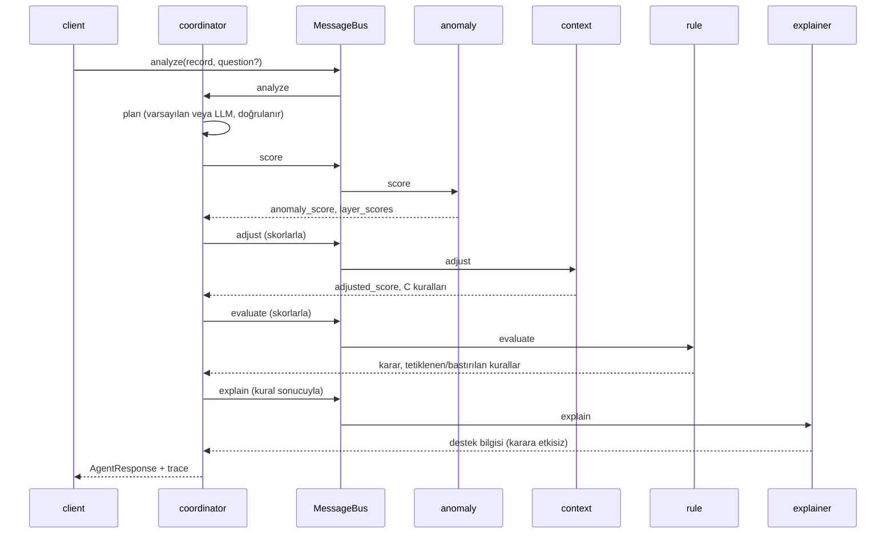

# Adım 9 - Çoklu agent orkestrasyonu (`src/agents/`)

**isFraud kullanıldı mı: hayır.** Agent katmanı (`src/agents/`, `configs/agents.yaml`, `scripts/run_agents_demo.py`) etiketi hiçbir yerde okumaz (`tests/agents/test_container.py` dosyaları tarar). Demo işlemleri yalnızca kural motorunun batch kararına göre seçildi (`reports/rules/rule_hits.parquet` içindeki `final_decision`).

Karar kayıtları: K-34 ... K-39 (`docs/decisions.md`). Bu doküman yalnızca ürünün içindeki runtime agent'ları anlatır.

## Ne yapıldı
Adım 4-8 servislerinin (anomali skoru, context düzeltme, kural motoru, RAG) tek bir isteği birlikte işlemesini sağlayan beş agent ve bir mesaj bus'ı yazıldı. Skor ve karar deterministik servislerden gelir; yerel LLM yalnızca (1) serbest metinli soruda hangi agent'ların çalışacağını planlamak ve (2) analist açıklamasını yazmak (RAG) için kullanılır.

## Agent rolleri
| Agent | Sorumluluk | Kullandığı servis (container) | Intent |
|---|---|---|---|
| `CoordinatorAgent` | İsteği alır, planı çıkarır, adımları bus ile delege eder, sonuçları birleştirir | `Planner` | `analyze` |
| `AnomalyAgent` | Katman skorları ve normalize toplam skor (Adım 4-5) | `scoring_service` | `score` |
| `ContextAgent` | Context düzeltmesi ve uygulanan C kuralları (Adım 6) | `context_adjuster` | `adjust` |
| `RuleAgent` | Kural değerlendirmesi, **tek karar kaynağı**, tetiklenen/bastırılan kurallar (Adım 7) | `rule_engine` | `evaluate` |
| `ExplainerAgent` | RAG ile analist açıklaması, "destek bilgisi" etiketli (Adım 8) | `rag_service` | `explain` |

Roller, izinli intent'ler, varsayılan plan, zaman aşımları ve planlayıcı prompt'u `configs/agents.yaml` içindedir.

## Mesaj formatı
`BusMessage` (pydantic v2), ortak `AgentMessage` türünü genişletir (`src/agents/messages.py`):

| Alan | Anlam |
|---|---|
| `message_id` | Mesaj başına benzersiz kimlik |
| `correlation_id` | Bir analist isteğindeki tüm mesajlar için aynı |
| `parent_id` | Gönderen hangi mesajı işlerken bunu yolladı (delegation zinciri) |
| `sender`, `recipient` | Agent adları (`client` dış çağıran) |
| `intent` | `analyze`, `score`, `adjust`, `evaluate`, `explain` |
| `payload` | Intent'e özgü, alıcı tarafından pydantic ile doğrulanan sözlük (`ScoreRequest`, `AdjustRequest`, `EvaluateRequest`, `ExplainRequest` ve cevap karşılıkları; fazladan alan reddedilir) |
| `timestamp`, `status` | UTC zaman, `ok` / `error` / `skipped` |

Trace (`TraceEntry`): `seq, message_id, parent_id, sender, recipient, intent, status, duration_ms, timestamp, payload_keys, detail`. Kayıt büyük olduğu için trace payload'ın yalnızca anahtarlarını tutar. `duration_ms` iç içe delegation'ı da kapsar. Bus dışı olaylar (`plan_fallback`) aynı listeye `recipient="-"` ile yazılır.

## Akış

Varsayılan plan: `anomaly:score -> context:adjust -> rule:evaluate -> explainer:explain`. Açıklama sorusu verilirse `question` hem planlayıcıya hem RAG sorgusuna gider.

### Delegation
Koordinatör her adıma o ana kadarki sonuçları verir. Bir adımda girdi eksikse agent onu bus üzerinden ister:
`RuleAgent` skor almamışsa `ContextAgent`'a `adjust` yollar; `ContextAgent` skor almamışsa `AnomalyAgent`'a `score` yollar. Böylece LLM planı `anomaly` ve `context` adımlarını atlasa bile zincir kurulur (aşağıdaki ikinci örnek). Agent'lar birbirini import etmez (`test_agents_do_not_import_each_other`).

### Planlama (K-37)
- Soru yoksa: varsayılan plan, LLM çağrılmaz.
- Soru varsa: yerel LLM'den `{"steps":[{"agent","intent"}]}` istenir. Pydantic doğrulaması: ek alan yok, yalnızca config'teki agent:intent çiftleri, tekrar yok, bağımlılık sırasında, `rule:evaluate` zorunlu. LLM kapalı, zaman aşımı (batch/demo 60 sn, API 10 sn), geçersiz JSON, izinsiz agent, sıra hatası veya eksik kural adımı: varsayılan plana düşülür ve trace'e `plan_fallback` + sebep yazılır.
- Plan karar kaynağını değiştiremez: kural adımı zorunlu, karar yalnızca `EvaluateReply`'dan kopyalanır, `ExplainReply` tipinde karar alanı yoktur. Testler: LLM'in "decision: allow" eklemesi reddedilir, açıklama metni "allow" dese de karar `block` kalır, kural adımsız plan reddedilir.

## Dayanıklılık (K-38)
| Durum | Sonuç |
|---|---|
| RAG cevabı boş / yalnızca kaynak satırı / LLM yok | Şablon açıklama, `origin=template`, trace'te `explanation_fallback` |
| ExplainerAgent hatası / zaman aşımı (240 sn) | Karar aynen döner, `explanation=null`, `status=degraded`, trace'te `explainer` `status=error` |
| Embedding çalışıyor, LLM kapalı | RAG retrieval-only döner (`llm_unavailable`, `text=null`); agent bunu boş sayıp şablon açıklamaya düşer, kaynaklar korunur |
| Ollama tamamen kapalı (embedding de yok) veya indeks kurulmamış | Retrieval yapılamaz (`EmbeddingUnavailableError` / `IndexNotBuiltError`); agent şablon açıklama döner, `flags=["rag_unavailable","explanation_fallback"]`, kaynak yok. RAG servisi agent'a sağlayıcı (provider) olarak verildiği için indeks yalnızca bu adımda yüklenir; skor, context, kural adımları ve trace etkilenmez (Adım 8-10 review, Ö1/Ö2) |
| Planlayıcı LLM hatası | Varsayılan plan, `plan_fallback` |
| Anomaly/Context hatası | Hata kaydedilir; RuleAgent skoru kendisi ister, o da başarısızsa `decision=null`, `status=error` |
| RuleAgent hatası | `decision=null`, `status=error`; karar uydurulmaz |
Bus hiçbir agent hatasını istisna olarak dışarı atmaz; delegation derinliği 6 ile sınırlıdır.

## Cooldown durumu (K-35, kullanıcı onayladı)
RuleAgent kural motorunu `update_state=False` ile çağırır: agent yolu K-27 online cooldown deposunu yazmaz, demo ve testler depoyu kirletmez. Karar: Adım 10'da yalnızca `/score` endpoint'i depoyu günceller; agent yolu ve diğer endpoint'ler salt okurdur. Bedeli: agent yolundan analiz edilen işlemler depoyu ilerletmez.

## Açıklama sorgusu ve şablona düşme (K-39)
- Sorgu kararın gerçek nedeninden kurulur. Analist sorusundaki görev cümleleri ("incele", "inceleme notu yaz", "sadece karar") çıkarılır. Geriye soru kalmaz ve karar kural tetiklenmeden skor eşiğinden gelmişse sorgu skor eşiğini, en yüksek iki katmanı ve operasyon rehberindeki review adımlarını hedefler; kural kararında varsayılan kural sorusu kullanılır.
- RAG cevabı boşsa, `null` ise (LLM yok) ya da yalnızca kaynak satırıysa şablon açıklama kullanılır: karar nedeni (`reasons`), en yüksek katman skorları, uygulanan C kuralları. Trace'e `explanation_fallback` yazılır; çıktı `origin="template"` ve yine "destek bilgisi" etiketlidir, karara etkisi yoktur.

## Gerçek demo (`make agents-demo`)
Holdout'tan kural motorunun batch kararına göre üç işlem seçilir (her karar grubunun ortadaki TransactionID'si; cooldown tarafından elenmiş satırlar atlanır, çünkü online depo boştur). Gerçek Ollama (qwen2.5:7b, bge-m3) ile çalıştırıldı; üçünde de online karar batch kararıyla aynı çıktı. Dosyalar: `reports/agents/trace_{block,review,allow}_<id>.json`, `summary.json`.

| TransactionID | Soru / plan | Karar | Tetiklenen | Context | Süre |
|---|---|---|---|---|---|
| 3522622 | yok / varsayılan (4 adım) | block (R01) | R01 | C3, C6b | 41,8 sn (açıklama 41,7 sn) |
| 3519086 | "incele ve inceleme notu yaz" / LLM: rule, explainer | review (skor eşiği) | - | C6a | 40,7 sn (plan 4,6 sn, açıklama 36,0 sn) |
| 3517771 | "sadece karar" / LLM: rule | allow | - | C1, C5, C9b | 3,7 sn (plan 3,6 sn) |

Örnek trace (TransactionID 3519086, LLM planı `rule:evaluate -> explainer:explain`; `rule` eksik skoru zincirle aldı):
```
1. client      -> coordinator  analyze   [ok]  40691 ms
2. coordinator -> rule         evaluate  [ok]    130 ms
3. rule        -> context      adjust    [ok]    120 ms   (delegation, parent = 2)
4. context     -> anomaly      score     [ok]    111 ms   (delegation, parent = 3)
5. coordinator -> explainer    explain   [ok]  35996 ms
```
Aynı işlemin yanıtından (kısaltılmış): `decision: "review"`, `decision_source: "score"`, `reasons: ["Karar kuralı tetiklenmedi; skor 1.079 inceleme eşiğinin (1.070) üzerinde."]`, `explanation: {label: "destek bilgisi", origin: "rag", affects_decision: false, grounded: true, ...}`. Görev cümlesi sorgudan çıkarıldığı ve karar skor eşiğinden geldiği için RAG `operations_guide#skor-kaynakli-review` ve `feature_dictionary#skor-alanlari` bölümlerini getirdi; metin skor eşiğini ve review adımlarını anlatıyor (önceki sürümde ilgisiz R07 kartı ve yalnızca kaynak satırı dönmüştü). Gerçek demoda şablona düşme gerekmedi; bu yol testlerle doğrulandı.

Block örneğinde (varsayılan plan) açıklama R01 kartından ve operasyon rehberinden alıntılı, `grounded=true`; yanıt kural gerekçesini (`0.88 USD küçük tutar ... son 1 saatte 15 önceki küçük işlem`) ayrıca `reasons` içinde taşır.

## Dosyalar
| Yol | İçerik |
|---|---|
| `src/agents/messages.py` | `BusMessage`, payload ve `AgentResponse`/`TraceEntry` modelleri |
| `src/agents/bus.py` | `MessageBus` (Mediator, trace, derinlik sınırı) |
| `src/agents/base.py` | `Agent` tabanı (`on(intent, handler)`, `delegate(...)`) |
| `src/agents/{anomaly,context,rule,explainer}_agent.py`, `coordinator.py` | Agent'lar |
| `src/agents/planner.py` | Varsayılan plan, LLM planı ve doğrulama |
| `src/agents/factory.py` | `AgentFactory`, planlayıcı LLM'i, `create_coordinator` |
| `src/agents/config.py`, `timeouts.py`, `errors.py` | Config modeli, sert zaman aşımı, istisnalar |
| `configs/agents.yaml` | Roller, plan, süreler, prompt |
| `scripts/run_agents_demo.py`, `reports/agents/` | Demo ve trace çıktıları |
| `tests/agents/` | 48 test (LLM, RAG, servisler sahte) |

Container (yalnızca ekleme): `agents_settings`, `message_bus`, `planner_llm`, `planner`, `agent_factory`, `coordinator` (hepsi Singleton). Testlerde `container.rule_engine.override(...)`, `container.rag_service.override(...)` vb. kullanılır. Tasarım desenleri: Mediator (bus), Factory (`AgentFactory`), Strategy/Chain (plan adımları sırayla), Repository (kural yükleme Adım 7'de).

## Komutlar
`make agents-demo` (en iyi sonuç için Ollama ve `make rag-index` gerekir; Ollama veya indeks yoksa demo yine biter: plan varsayılana düşer, açıklama şablondan gelir). Testler: `make test` (Ollama gerekmez).

## Bilinen sınırlar
- **Gecikme:** açıklama adımı 16-42 sn (RAG, yerel 7B model; ilk istekte model yükleme dahil), LLM planı 3,5-4,6 sn. Karar ise 0,1-0,2 sn'de hazırdır; asıl bekleyen açıklamadır. Bus eşzamanlıdır (K-36), bir istek bitene kadar bir worker meşgul olur.
- **"Grounded" sınırı:** Adım 8'deki kaynak kontrolü yalnızca anılan chunk id'lerinin getirilenler arasında olduğunu doğrular, içeriğin doğruluğunu değil. 3519086'nın yeni açıklaması `grounded=true` ama içerik hatası var: "entity" katmanını "cihaz geçmişine bakılır" diye anlatıyor ve eşiği "1,070'den büyük olmalı" diye yorumluyor (skor kaynaklı review'da ölçüt skorun eşiğe ulaşmasıdır). 7B model bağlamı yer yer yanlış özetliyor. Bu yüzden çıktı "destek bilgisi"dir; karar ve gerekçe `reasons` alanındadır.
- **Görev cümlesi tespiti regex tabanlıdır** (`explainer.task_patterns`); listede olmayan bir görev ifadesi sorguda kalabilir. Boş-cevap kontrolü yalnızca boş/kaynak-satırı durumunu yakalar, yanlış ama dolu cevabı yakalamaz; abstain ("bilgi yok") cevabı da şablona düşürülmez.
- **LLM planının değeri sınırlı:** plan yalnızca yardımcı agent'ların seçimini etkiler (örn. açıklama atlayıp ~30 sn kazanmak). Planın kalitesi ölçülmedi; küçük bir soru kümesiyle değerlendirilmedi.
- **Zaman aşımında arka plan thread'i:** süre dolunca istek döner, ama LLM/RAG çağrısı HTTP timeout'una kadar arka planda sürer (daemon thread).
- **Retry ve paralellik yok;** mesajlar süreç içidir, kalıcı kuyruk yoktur.
- **Online kayıt hazır gelir:** agent'lar feature'lı kaydı bekler (`entity_key`, `has_device`, `email_ent_known`, cooldown anahtarları dahil); ham işlemden bu kaydı üretmek API adımının işidir. Demo kaydı `data/processed` parquet'lerinden kurar.
- **Agent yolu cooldown depoya yazmaz** (K-35); Adım 10'da yalnızca `/score` yazar.
- **Açıklama sorgusu:** görev cümleleri regex ile çıkarıldıktan sonra kalan metin RAG sorgusu olur (K-39); LLM tabanlı yeniden yazım yoktur.

## Bir sonraki adımın girdisi (Adım 10: API)
- `Container.coordinator().analyze(AnalystRequest(record=..., question=...)) -> AgentResponse` tek giriş noktasıdır; yanıt `decision`, `reasons`, `explanation` (destek bilgisi) ve `trace` içerir.
- API ham işlemden feature'lı kaydı üretmeli (Adım 3 `FeaturePipeline`) ve zaman aşımlarını (açıklama 240 sn) HTTP seviyesinde ele almalı; sync endpoint veya iş kuyruğu seçimi gerekir.
- Cooldown deposu: yalnızca `/score` `update_state=True` ile günceller; agent yolu ve diğer endpoint'ler salt okur (K-35).
