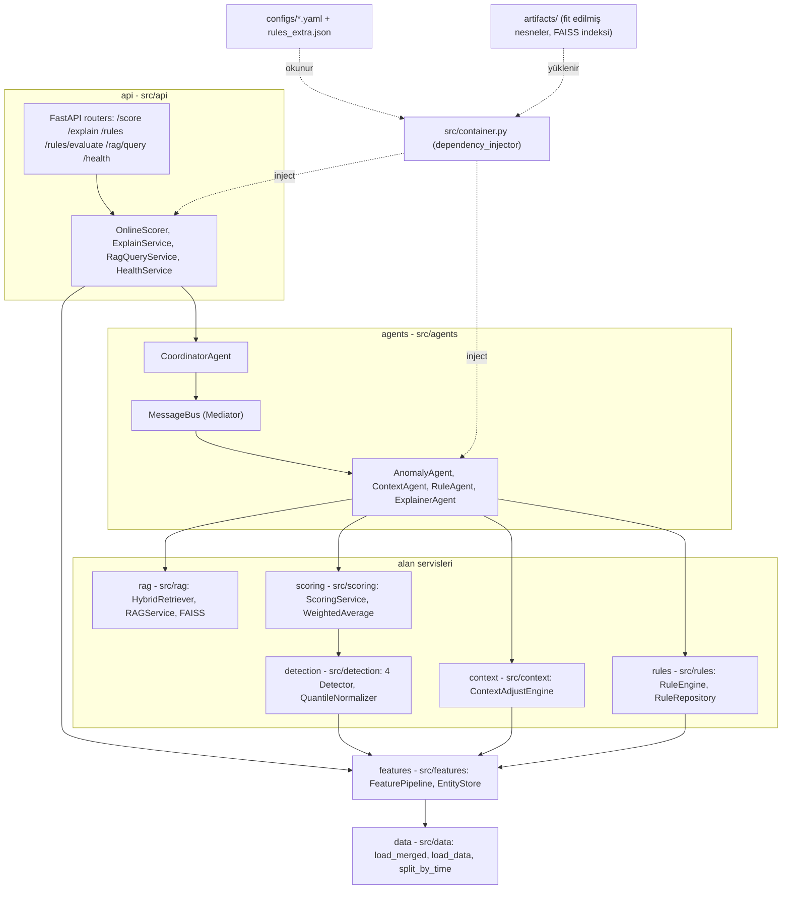
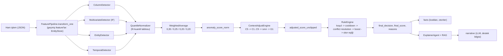
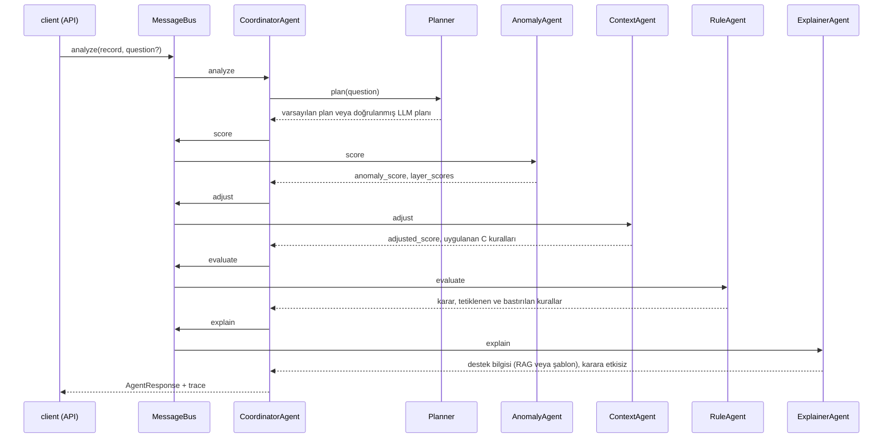

# Teknik Doküman: Fraud & Anomaly Detection Platform

IEEE-CIS Fraud Detection verisi (train_transaction + train_identity) üzerinde çok katmanlı, etiketsiz
(unsupervised) anomali tespiti; bağlama duyarlı skor düzeltme (context adjust); YAML/JSON ile
konfigüre edilen kural motoru; yerel LLM ile RAG; çoklu agent orkestrasyonu ve FastAPI servisi.

Bu dokümandaki her sayı `reports/` altındaki bir dosyadan veya `docs/step0.md` ... `docs/step10.md`,
`docs/decisions.md`, `docs/assumptions.md`, `docs/eda.md` dosyalarından alınmıştır; kaynak her
tablonun altında yazılıdır. Aksi belirtilmedikçe sayılar **tam veri** koşusuna aittir (fit 472.432,
holdout 118.108 satır). `SAMPLE_N=50000` örneklem sonuçları yalnızca duman testidir ve ayrıca
işaretlenmiştir. Karar kayıtlarına `K-xx` biçiminde atıf yapılır (`docs/decisions.md`).

## İçindekiler
0. [Özet ve ana sonuçlar](#0-özet-ve-ana-sonuçlar)
1. [Mimari diyagramlar](#1-mimari-diyagramlar)
2. [Katmanlar ve sorumlulukları](#2-katmanlar-ve-sorumlulukları)
3. [Tasarım desenleri](#3-tasarım-desenleri)
4. [Veri ve varsayımlar](#4-veri-ve-varsayımlar)
5. [Feature engineering, anomali katmanları ve skor birleştirme (Adım 3-5)](#5-feature-engineering-anomali-katmanları-ve-skor-birleştirme-adım-3-5)
6. [Context Adjust (Adım 6)](#6-context-adjust-adım-6)
7. [Rule Engine (Adım 7)](#7-rule-engine-adım-7)
8. [Önce / sonra false positive tablosu](#8-önce--sonra-false-positive-tablosu)
9. [EDA tutarlılık tablosu](#9-eda-tutarlılık-tablosu)
10. [RAG (Adım 8)](#10-rag-adım-8)
11. [Agent orkestrasyonu (Adım 9)](#11-agent-orkestrasyonu-adım-9)
12. [API (Adım 10)](#12-api-adım-10)
13. [Bilinen sınırlar ve gelecek iş](#13-bilinen-sınırlar-ve-gelecek-iş)

---

## 0. Özet ve ana sonuçlar

**Problem.** Kart işlemlerinde dolandırıcılık şüphesini etiket kullanmadan tespit etmek, skoru iş
bağlamına göre düzeltmek, karar vermek (block / review / allow) ve kararı analiste açıklamak.

**Yaklaşım.**
1. Dört anomali katmanı (column, multivariate, entity, temporal), fit kuantil tablosuyla [0,1]'e
   normalize edilir ve ağırlıklı ortalamayla birleştirilir (Adım 4-5).
2. Context kuralları (C1-C9, G1) skoru çarpımsal olarak düzeltir (Adım 6).
3. Kural motoru (R01-R12) karar verir, risk artışı (boost) ekler ve gerekçeyi gerçek değerlerle yazar (Adım 7).
4. RAG ve agent'lar kararı açıklar; LLM karar vermez, yalnızca "destek bilgisi" üretir (Adım 8-9).
5. Aynı kod batch (parquet) ve online (API) yolunda çalışır (Adım 10).

`isFraud` hiçbir feature, model, ağırlık, eşik veya kural seçiminde kullanılmadı; yalnızca
`src/data/loader.py` içinde ayrı `y` olarak ayrılır ve `src/evaluation/` içinde metrik için okunur.

**Ana sonuçlar (tam veri, holdout: 118.108 satır, 4.064 pozitif, taban oranı %3,44).** Alarm bütçesi
holdout'un en yüksek skorlu %1'i (1.182 işlem) veya %5'idir (5.906 işlem).

| Aşama (sıralama skoru) | PR-AUC | ROC-AUC | Precision@%1 | Recall@%1 | FP@%1 | Precision@%5 | Recall@%5 | FP@%5 |
|---|---|---|---|---|---|---|---|---|
| Adım 5: birleşik anomali skoru (`anomaly_score_norm`) | 0,081 | 0,683 | 0,158 | 0,046 | 995 | 0,116 | 0,168 | 5.222 |
| Adım 6: context düzeltmesi, revize (`adjusted_score_unclipped`) | **0,094** | 0,686 | **0,168** | **0,049** | **983** | **0,142** | **0,206** | **5.068** |
| Adım 7: kural motoru, düzeltilmiş (`final_score_unclipped`) | 0,082 | 0,683 | 0,156 | 0,045 | 998 | 0,130 | 0,189 | 5.137 |

Kaynak: `reports/rules/budget_comparison.csv`, `reports/scores/holdout_metrics.csv`.

Kısa yorum: sinyal zayıf (denetimsiz skor için beklenen düzey). Context düzeltmesi FP'yi %1'de 12,
%5'te 154 azalttı. Kural boost'ları sıralamayı Adım 6'nın üstüne çıkarmadı (ana kaynak R04); R01
(card testing) belirgin fayda sağlıyor. Kurallar holdout etiketine göre ayarlanmadı (K-24). Ayrıntı:
[Bölüm 8](#8-önce--sonra-false-positive-tablosu).

---

## 1. Mimari diyagramlar

### 1.1 Katmanlar ve bağımlılık yönü
Katman bağımlılık yönü `api -> agents -> (rag, rules, context, scoring, detection) -> features -> data`
şeklindedir; ters yönde import yoktur (testlerle kontrol edilir: alt katmanlar `src.api` import etmez,
agent'lar birbirini import etmez).



### 1.2 Tek işlemin akışı: skor -> context -> kural -> açıklama
Batch ve online yol aynı fonksiyonları kullanır. Online yolda tek işlem tek satırlı bir DataFrame
olarak aynı koddan geçer (`src/api/online.py`).



Batch yolu `make pipeline` ile çalışır: `profile -> features -> score -> context -> rules`
(`scripts/run_pipeline.py`). RAG indeksi ayrı bir adımdır (`make rag-index`, Ollama gerekir, K-43).

### 1.3 Agent akışı (ürün içi runtime agent'lar)



LLM planı `anomaly` ve `context` adımlarını atlarsa RuleAgent eksik skoru bus üzerinden ContextAgent'tan,
ContextAgent da AnomalyAgent'tan ister (delegation; [Bölüm 11](#11-agent-orkestrasyonu-adım-9)).

---

## 2. Katmanlar ve sorumlulukları

| Katman | Klasör | Sorumluluk | Ana sınıf / fonksiyon |
|---|---|---|---|
| data | `src/data/` | CSV okuma, LEFT JOIN, dtype downcast, zaman sırası, `isFraud`'u ayrı `y` olarak ayırma, zaman bazlı split | `load_merged`, `load_data`, `split_by_time`, `add_datetime` |
| profiling | `src/profiling/` | Kolon tipi, eksik veri, aykırı değer, ilişki, entity adayı karşılaştırması, EDA (etiketsiz kısım) | `scripts/run_profiling.py`, `scripts/eda_report.py` |
| features | `src/features/` | 62 elle tasarlanmış feature + 209 ham kolon; fit istatistikleri; geçmiş-only feature'lar (batch ve online) | `FeaturePipeline` (`fit`, `transform`, `transform_one`), `EntityStore` |
| detection | `src/detection/` | Dört anomali katmanı, ön işleme, fit kuantil normalizasyonu | `LayerDetector`, `ColumnDetector`, `MultivariateDetector`, `EntityDetector`, `TemporalDetector`, `QuantileNormalizer`, `build_detector` |
| scoring | `src/scoring/` | Katmanları birleştirme, ablation, servis (batch + tek kayıt) | `WeightedAverage`, `ScoringService` |
| context | `src/context/` | Bağlama duyarlı çarpımsal düzeltme | `ContextAdjustEngine` (`adjust_batch`, `adjust_one`) |
| rules | `src/rules/` | Şema doğrulama, koşul dili, cooldown, conflict resolution, gerekçe şablonları | `RuleRepository`, `RuleEngine`, `resolve`, `CooldownStore` |
| rag | `src/rag/` | Bilgi tabanı üretimi, chunking, embedding, FAISS, hibrit retrieval, prompt, cevap güvenilirliği | `kb_builder`, `chunker`, `OllamaEmbedder`, `FaissVectorStore`, `HybridRetriever`, `RAGService` |
| agents | `src/agents/` | Runtime agent'lar, mesaj bus'ı, planlayıcı | `CoordinatorAgent`, `MessageBus`, `Planner`, `AgentFactory` |
| api | `src/api/` | HTTP katmanı, online geçmiş, facts/narrative ayrımı, hata zarfı | `create_app`, `OnlineScorer`, `ExplainService`, `RagQueryService`, `HealthService` |
| evaluation | `src/evaluation/` | Etiketli metrikler (yalnızca raporlama) | `metrics.py`, `rule_metrics.py`, `base_rate.py`, `fraud_rate.py` |
| core | `src/core/` | Ortak arayüzler, tipler, config okuma, seed | `interfaces.py`, `types.py`, `config.py` |

Ortak arayüzler (`src/core/interfaces.py`, ABC): `Detector`, `Aggregator`, `Normalizer`,
`ContextAdjuster`, `RuleEvaluator`, `Embedder`, `Retriever`, `LLMClient`, `BaseAgent`, `RuleStore`.

Sabitler tek kaynakta: seed, referans tarih, split oranı ve alarm bütçeleri `configs/settings.yaml`
içindedir (K-02). Kural, context, ağırlık, RAG, agent ve API parametreleri ilgili `configs/*.yaml`
dosyasındadır; kod içinde eşik yazılmaz.

---

## 3. Tasarım desenleri

| Desen | Nerede | Ne sağlıyor |
|---|---|---|
| **Strategy** | `Detector` arayüzü (`src/core/interfaces.py`) ve uygulamaları: `src/detection/column.py`, `multivariate.py`, `entity.py`, `temporal.py` (ortak taban `src/detection/base.py` `LayerDetector`). `Aggregator` uygulamaları: `src/scoring/aggregation.py` (`WeightedAverage`, `MaxAggregator`, `NoisyOrAggregator`, `CorrelationWeighted`). `Normalizer` -> `src/detection/normalization.py` `QuantileNormalizer` | Katman veya birleştirme yöntemi değiştirilebilir; ablation aynı arayüzle alternatif aggregator'ları karşılaştırır |
| **Factory** | `src/detection/factory.py` (`build_detector`, `build_all`; `configs/anomaly.yaml`'dan katman kurar), `src/agents/factory.py` (`AgentFactory`, `create_coordinator`, `build_planner_llm`), `src/rules/factory.py` (`load_rule_engine`), `src/context/factory.py` (`load_engine`) | Nesne kurulumu tek yerde; container factory'leri çağırır |
| **Chain of Responsibility / Pipeline** | `src/context/engine.py` `ContextAdjustEngine._core` (C5 ağırlık -> çarpanlar -> dışlayıcı grup -> sınırlar -> G1 koruması -> kırpma); `src/rules/engine.py` `RuleEngine` (türetilmiş kolon -> koşul -> cooldown -> `resolve` -> boost -> skor eşiği -> gerekçe); `src/api/online.py` `OnlineScorer.evaluate` (feature -> skor -> context -> kural); `scripts/run_pipeline.py` (batch adımları) | Her aşama tek iş yapar, sırası açık ve test edilebilir |
| **Mediator** | `src/agents/bus.py` `MessageBus` | Agent'lar birbirini tanımaz; her mesaj tek noktadan geçer, trace ve derinlik sınırı (6) orada (K-34, K-36) |
| **Repository** | `src/rules/repository.py` `RuleRepository` (`RuleStore` arayüzü: YAML + JSON yükleme, `reload()`, istekte gelen kural seti için `parse()`); `src/data/loader.py` (`load_merged`, `load_data`: tek veri erişim yolu); `src/rag/store.py` `FaissVectorStore` (bilgi tabanı vektör/metaveri erişimi) | Veri, kural ve bilgi tabanı kaynağı iş mantığından ayrılır |
| **Dependency Injection** | `src/container.py` (`dependency_injector` `DeclarativeContainer`); FastAPI endpoint'leri `@inject` + `Provide[Container.x]` (`src/api/routers/`) | Model, kural seti, vector store, LLM istemcisi Singleton; testlerde `container.x.override(mock)` |

**DI container yapısı (`src/container.py`).** Tüm sağlayıcılar Singleton'dır ve yalnızca yükleme yapar
(eğitim yok):
- Adım 3-7: `artifact_set` (`SAMPLE_N`'e göre tam veri veya örneklem yolları, K-47), `feature_pipeline`,
  `scoring_service`, `context_adjuster`, `rule_repository`, `cooldown_store`, `rule_engine`.
- Adım 8: `rag_settings`, `embedding_http_client`, `llm_http_client`, `embedder`, `llm_client`,
  `vector_store` (indeks yoksa `IndexNotBuiltError`), `retriever`, `prompt_builder`, `rag_service`.
- Adım 9: `agents_settings`, `message_bus`, `planner_llm`, `planner`, `agent_factory`, `coordinator`.
  `AgentFactory` RAG servisini nesne olarak değil sağlayıcı olarak alır (`rag_service.provider`); indeks
  yalnızca açıklama adımı çalışınca yüklenir (K-44).
- Adım 10: `api_settings`, `online_scorer`, API'ye özel ikinci agent kopyası (`api_message_bus`,
  `api_planner`, `api_agent_factory`, `api_coordinator`; daha kısa LLM süresiyle, K-41),
  `explain_service`, `rag_query_service`, `health_service`.

---

## 4. Veri ve varsayımlar

### 4.1 Birleştirme ve şekil
- `train_transaction.csv` (590.540 satır) ana tablo; `train_identity.csv` (144.233 satır)
  `TransactionID` ile **LEFT JOIN**. Eşleşen satır 144.233 (%24,4); identity kaydı olmayan satırlar
  korunur, `has_identity` bayrağı üretilir. Join sonrası 590.540 satır, tekrar eden `TransactionID` yok.
- Çıktı `data/processed/merged.parquet`: 433 kolon, `isFraud` yok. Bellek için chunk'lı okuma,
  float64 -> float32 ve tamsayı downcast, düşük cardinality string -> `category` (`load_merged`).
- `ProductCD = W` olan 439.670 satırın hiçbirinde identity kaydı yok (Cramér's V = 0,97): identity
  eksikliği W ürününde yapısaldır.

Kaynak: `docs/step1.md`.

### 4.2 Zaman, split ve geliştirme modu
- **Referans tarih (varsayım):** `TransactionDT` saniye cinsinden ofsettir;
  datetime = 2017-12-01 00:00:00 + TransactionDT (`configs/settings.yaml`). Gerçek takvim tarihi bilinmiyor.
  Destekleyen işaret: veride 2017-12-19 ... 2017-12-26 arasında hacim tepesi var (Noel dönemiyle örtüşme;
  kanıt değil). Veri ~183 günü kapsar.
- **Zaman bazlı split:** TransactionDT sıralı ilk %80 fit (472.432 satır), son %20 holdout (118.108 satır).
  Tüm istatistik, eşik, kuantil tablosu ve model fit kümesinde öğrenilir; metrikler holdout'ta raporlanır.
  Rastgele split yok.
- **SAMPLE_N:** ortam değişkeni verilirse loader transaction dosyasının ilk N satırını okur
  (dosya zamana göre sıralı; loader okunanları yine sıralar), identity bu ID'lere göre filtrelenir (K-03).
  Örneklem çıktıları `*_sample` / `sample/` yollarına yazılır, tam veri çıktılarını ezmez. API de aynı
  değişkeni okuyup örneklem artifact'larıyla açılır (K-47).
- **Seed:** 42 (`settings.yaml`). `random` ve `numpy` `set_seed` ile, scikit-learn `random_state=42`
  parametresiyle; FAISS `IndexFlatIP` kesin (deterministik) arama yapar.
- **Etiket:** taban oranı tüm veride %3,50, fit %3,51, holdout %3,44 (`reports/profile/label_base_rate.csv`).

### 4.3 Eksik veri
Grup bazlı eksiklik (`reports/profile/group_missing.csv`): id %85, dist %77, D %58, M %50, V %43,
addr %11, card %0,5, C %0. V kolonları 15 eksiklik bloğuna ayrılır. %90'dan fazla eksik 12 kolon var
(dist2, D7, id_07, id_08, id_18, id_21-id_27).

Uygulanan yaklaşım:
- Feature'larda NaN korunur; "eksik" çoğu yerde kendi seviyesidir (frekans tablosunda NaN bir değerdir,
  entity anahtarında addr1 NaN ayrı seviye).
- Isolation Forest NaN kabul etmediği için NaN fit medyanıyla doldurulur ve fit'te NaN görülen her kolon
  için `<kolon>__na` bayrağı eklenir (K-11). `time_since_last_txn` ve `avg_inter_arrival` içindeki -1
  sentinel ("geçmiş yok") NaN'a çevrilir.
- Kural ve context koşul dillerinde NaN hiçbir karşılaştırmayı sağlamaz; yalnızca `isna` / `is_null` görür.
- R_emaildomain boşluğu yapısal kabul edilir (karşı taraf gerektirmeyen işlemler; `has_recipient` bayrağı).

### 4.4 Yüksek cardinality
Yüksek cardinality (>1000 benzersiz): `card1` (13.553), `DeviceInfo` (1.786). Orta ama frekans kodlaması
uygun: `card2` (500), `addr1` (332), `id_33` (260), `id_31` (130), `card5`, `card3`, `id_30`, `addr2`,
`P_emaildomain` (59), `R_emaildomain` (60) (`docs/step1.md`).

Karar: **one-hot ve target encoding yok.** Frequency encoding: `freq_{card1, addr1, P_emaildomain,
R_emaildomain, DeviceInfo, id_30, id_31, id_33}` = değerin fit kümesindeki payı; fit'te görülmeyen
değer 0 (`configs/entity.yaml` `features.freq_columns`). Seyrek kombinasyon (`os_browser_rare`: id_30 +
id_31, fit payı < 1e-4) ayrı bir bayraktır. V kolonları için fit kümesinde |Spearman| >= 0,95 kümeleri
bulunup küme başına bir temsilci tutuldu: 339 -> 185 (`reports/profile/redundancy_clusters.csv`).

### 4.5 Entity proxy
Veride `user_id` yok. Karar: **entity = `card1 + addr1`, addr1 NaN ayrı seviye** (`configs/entity.yaml`,
K-05). Tüm adımlar anahtarı buradan okur.

Karşılaştırma (etiketsiz, tam veri, `reports/profile/entity_patterns.csv`):

| Aday | Tanımsız satır | Entity sayısı | İşlem/entity medyan / p99 / max | Geçmişi olan satır | Holdout'ta fit'te görülen | İçi log-tutar std |
|---|---|---|---|---|---|---|
| A: card1 | %0 | 13.553 | 4 / 786 / 14.932 | %97,7 | %98,9 | 0,65 |
| **H: card1 + addr1 (NaN seviye)** | **%0** | **39.974** | **2 / 201 / 9.928** | **%93,2** | **%95,8** | **0,59** |
| I: card1 + addr1 + D1n | %0 | 217.850 | 1 / 20 / 1.414 | %63,1 | %43,5 | 0,35 |
| J: I + P_emaildomain | %0 | 273.919 | 1 / 15 / 1.414 | %53,6 | %39,9 | 0,29 |

Gerekçe: I ve J daha homojen ama holdout satırlarının yarıdan fazlasında entity fit'te hiç görülmüyor
(geçmiş tabanlı feature'lar soğuk başlar). H tüm satırları kapsar ve holdout'ta %95,8 tanınır; A birden
çok kartı birleştirir (max 14.932 işlem). D1 anahtara girmez, iki ayrı feature olur: kart yaşı
`card_age_days = D1` ve kart başlangıç günü `D1n = floor(TransactionDT/86400) - D1`. "D1 = kart
yaşı" yorumu veriyle desteklenir ama kanıt değildir: (H, D1n) çifti satırların %63,2'sinde daha önce
görülmüş, D1 karıştırılınca %33,0 (`reports/profile/d1_semantics.csv`).

Bilinen sonuç: H bir kişi değil, yaklaşık bir **kart grubudur**. Holdout'ta temporal skorun en yüksek
%1'inin %96,4'ü tek bir entity'ye (card1 15775, addr1 330) aittir; addr1 boş satırlar da tek bir
seviyede toplanır (card1 15885). Bu sınır Adım 5-7 sonuçlarını etkiler (`docs/assumptions.md` varsayım 6).

### 4.6 Varsayımlar tablosu (özet)
Tam tablo: `docs/assumptions.md`.

| # | Varsayım | Durum |
|---|---|---|
| 1 | Referans tarih 2017-12-01 + TransactionDT | kısmen (hacim tepesi Noel dönemiyle örtüşüyor) |
| 2 | Yerel saat = referans saat - 6 (fit'te en düşük hacimli 6 saat yerel 00-06 kabul) | varsayım |
| 3 | addr2 = 87 ABD, tutarlar USD | varsayım |
| 4 | Hafta sonu referans takvimine göre | kısmen |
| 5 | D1 = kart yaşı | kısmen |
| 6 | Entity = card1 + addr1 kart grubudur | kısmen |
| 7 | 3 ondalıklı tutar = olası kur çevrimi | varsayım |
| 8 | R_emaildomain boşluğu yapısal | varsayım |
| 9 | Etiket gürültülü ve aynı kart/e-postaya yayılıyor | varsayım |
| 10 | Tatil sezonu penceresi tek bir Aralık'tan öğrenildi | varsayım |
| 11 | Resmi tatiller hacmi değiştirir | reddedildi (oran 1,00) |

---

## 5. Feature engineering, anomali katmanları ve skor birleştirme (Adım 3-5)

### 5.1 Feature'lar (Adım 3)
`data/processed/features.parquet`: 271 kolon = 62 elle tasarlanmış + 209 ham (V 185, C 13, D 11).

| Grup | Sayı | Örnekler |
|---|---|---|
| temporal | 10 | `hour`, `day_of_week`, `is_weekend`, `is_low_volume_window`, `local_hour_est`, `is_business_hours`, `holiday_season` |
| entity (geçmiş + velocity + kart) | 24 | `ent_txn_count`, `ent_avg_amt`, `amt_ratio_to_ent_avg`, `amt_zscore_ent`, `time_since_last_txn`, `ent_cnt_{1h,6h,24h,7d}`, `ent_sum_*`, `small_amt_streak_1h`, `card_age_days`, `is_new_card` |
| relational | 7 | `card_new_addr`, `device_ent_match`, `has_recipient`, `email_mismatch`, `foreign_addr2`, `addr2_missing`, `os_browser_rare` |
| context | 21 | `amt_log`, `amt_n_decimals`, `amt_has_3dec`, `amt_fit_freq`, `has_identity`, `dist*_log`, `freq_*` (8) |
| passthrough | 209 | V/C/D küme temsilcileri |

Fit'ten öğrenilenler (`configs/entity.yaml` `learned:`): düşük hacim penceresi başlangıcı 06 (fit
hacminin %4,07'si), yerel ofset -6, küçük tutar eşiği 25,95 (fit TransactionAmt q10), baskın addr2 87,
tatil sezonu 2017-12-19 ... 2017-12-26.

**Sızıntı önlemleri.** Geçmiş feature'lar yalnızca önceki işlemlerden hesaplanır (satırın kendisi ve
sonrası sayılmaz; aynı saniyede küçük TransactionID önce gelir). Fit istatistikleri yalnızca fit
kümesinden öğrenilir. Testler: gelecek satırların geçmiş feature'ları değiştirmemesi, satırın kendi
geçmişine girmemesi, batch = online eşitliği. Tam veride 500.000 satırlık store'dan sonraki 2.000 satır
online hesaplanıp batch ile karşılaştırıldı: 0 fark (`docs/step3.md`).

### 5.2 Dört anomali katmanı (Adım 4)
Her katman `Detector` arayüzünü uygular: `fit(df)`, `score(df) -> [0,1]`, `explain(row) -> dict`.
Parametreler `configs/anomaly.yaml` içindedir.

| Katman | Yöntem | Neden | `explain` çıktısı |
|---|---|---|---|
| column (K-12) | 28 açıklanabilir kolonda iki yönlü ECDF kuyruk skoru `-log10(2*min(F,1-F))`; ayrık kolonlarda `-log10(frekans)`; satır = en yüksek 3 kolonun ortalaması | Dağılım şeklinden bağımsız, p-değeri gibi okunur. Tüm ~251 kolonda top-3 doyuyordu (örneklemde skor >= 2 olan satır %39,6 vs 28 kolonla %17,4) | En sapan 3 kolon, değeri, kuyruk skoru |
| multivariate (K-13) | Isolation Forest (200 ağaç, max_samples 256, seed 42); girdi IF-core: 75 kolon + 15 eksiklik bayrağı = 90 | Ölçeklenir, ölçekleme gerektirmez, seed ile tekrarlanır. LOF O(n^2) ve online'da fit verisine bağlı. V kolonları yorumlanamadığı için IF-full (460 girdi) yalnızca ablation'da | Feature'ı fit medyanına çekince ham skor düşüşü; en büyük 5 katkı |
| entity (K-14) | `w*E + (1-w)*G`, `w = n/(n+5)`; E = entity'ye göre tutar z-skoru, log tutar oranı, yeni cihaz; G = global tutar kuyruğu, cihaz nadirliği, `card_new_addr` nadirliği | Yumuşak geri çekme süreklidir; ilk işlemde (`w=0`) global sinyale düşer. Örneklem holdout'unda satırların %18,2'si ilk işlem | `w`, E, G, ham sinyaller |
| temporal (K-15) | Beş alt skor (`-log10 p` biriminde, eşit ağırlık 0,2): velocity, inter-arrival kısalığı, düşük hacim penceresi, entity saat nadirliği (k=5 geri çekme), (gün, saat) hacim sapması | Alt skorlar tek tek açıklanabilir; hacim sapması fit paylarına dayalı durumsuz sürüm (batch = online eşitliği için) | Beş alt skor |

Ömür boyu büyüyen kümülatif kolonlar (`ent_txn_count`, `ent_avg_amt`, `ent_age_days` vb.) ve takvimde
mutlak konum (`day_index`, `card_start_day`) multivariate ve column girdisinden çıkarılır; zamanla
büyüdükleri için IF holdout satırlarını "geç tarih" diye anomali sayardı. Pencereli velocity sayımları
(`ent_cnt_*`, `ent_sum_*`) kalır (K-18, düzeltilmiş).

### 5.3 Normalizasyon ve birleştirme (Adım 5)
- **Normalizasyon (K-16):** her katmanın ham skoru fit satırlarındaki 1001 noktalı kuantil tablosuyla
  `np.interp` ile [0,1]'e çevrilir; bağlar ortalama rank alır; fit dışı değer 0/1'e kırpılır. Neden:
  katmanların ham ölçekleri farklı (IF ve `-log10 p`); rank tabanlı yöntem karşılaştırılabilir ve uç
  değerlere dayanıklıdır; tablo fit'ten geldiği için holdout'a sızıntı yok. Ham ve normalize skor ikisi de
  saklanır (`artifacts/detectors/normalization_table.parquet`).
- **Birleştirme (K-17):** `raw_anomaly_score = 0,35*multivariate + 0,25*entity + 0,20*column +
  0,20*temporal` (`configs/weights.yaml`). Katman katkıları `contrib_*` sütunlarındadır. Toplam kendi fit
  kuantil tablosuyla tekrar normalize edilir (`anomaly_score_norm`, monoton; sonraki adımlar bunu okur, K-19).
- **Ağırlıkların gerekçesi:** etiketsiz ve elle; en geniş görüşlü katman (multivariate) en yüksek, en dar
  kapsamlı katmanlar (column, temporal) en düşük. Holdout sonucuna bakılarak değiştirilmedi.

Holdout sonuçları (tam veri, `reports/scores/holdout_metrics.csv`, `reports/scores/ablation.csv`):

| Kapsam | PR-AUC | ROC-AUC | Recall@%1 | Recall@%5 |
|---|---|---|---|---|
| multivariate | 0,088 | 0,695 | 0,038 | 0,197 |
| entity | 0,047 | 0,577 | 0,012 | 0,088 |
| column | 0,057 | 0,621 | 0,029 | 0,125 |
| temporal | 0,046 | 0,598 | 0,001 | 0,070 |
| **birleşik (ağırlıklı ortalama)** | **0,081** | **0,683** | **0,046** | **0,168** |
| alternatif: korelasyon ağırlıklı (B) | 0,068 | 0,667 | 0,042 | 0,128 |
| alternatif: max | 0,056 | 0,645 | 0,008 | 0,104 |
| alternatif: noisy-OR | 0,069 | 0,668 | 0,024 | 0,147 |
| varyant: IF-full (V dahil) | 0,091 | 0,722 | 0,049 | 0,173 |

Neden ağırlıklı ortalama: yorumlanabilir, katkı satır bazında görülür, ağırlık config'ten değişir.
Korelasyonla ters orantılı ağırlık (B) etiketsizdir ama temporal'e 0,475 ağırlık verip onu ana belirleyici
yapıyordu (`reports/scores/corr_weights.csv`); max ve noisy-OR tek gürültülü katmana duyarlı ve doyuyor.
IF-full daha yüksek metrik verdi ama V kolonları yorumlanamadığı için ana skora alınmadı.

Temporal katmanın recall@%1 = 0,001 değeri tek bir davranışı ölçer: holdout'ta temporal üst %1'in
1.181 işleminin 1.138'i (%96,4) tek entity'nin (card1 15775, addr1 330) burst'üdür (`docs/step5.md`).

Örneklem (SAMPLE_N=50000, 10.000 holdout, 228 pozitif; duman testi): birleşik PR-AUC 0,050, ROC-AUC 0,635.

---

## 6. Context Adjust (Adım 6)

### 6.1 Amaç ve akış
`ContextAdjustEngine` (`src/context/engine.py`, `ContextAdjuster` arayüzü) Adım 5 skorunu
(`anomaly_score_norm`) iş bağlamına göre çarpımsal olarak düzeltir. Kurallar kodda değil
`configs/context.yaml` içindedir (`id`, `group`, `name`, `description`, `type`, `condition`, `factor`,
`rationale`). Batch (`adjust_batch`) ve tek kayıt (`adjust_one`) aynı `_core` fonksiyonunu kullanır (K-01).

Zincir (Chain of Responsibility):
1. **C5 (`layer_weight`):** temporal katman ağırlığı yarıya indirilir, Adım 5 toplamı yeniden hesaplanıp
   Adım 5'in fit kuantil tablosundan geçirilir; değişim çarpan olarak ifade edilir. Yalnızca skoru
   düşürürse uygulanır (`only_if_lowers: true`).
2. **Çarpımsal kurallar (C1-C4, C6-C9):** eşleşen kurallar çarpılır. Dışlayıcı grup `geo_product`
   (C6a, C6b, C9a, C9b): aynı satırda birden fazlası tetiklenirse yalnızca en büyük çarpan uygulanır
   (eşitlikte config'teki ilk kural).
3. **Sınırlar:** toplam çarpan [0,5; 1,5] aralığına kırpılır.
4. **G1 koruması (card testing):** `small_amt_streak_1h >= 2` ise toplam çarpan 1,0'ın altına inemez.
5. `adjusted_score_unclipped = raw_score x toplam` (alarm sıralaması bununla);
   `adjusted_score = clip(..., 0, 1)` yalnızca gösterim içindir.

Koşul dili: `all:` altında `{feature, op, value}` (`== != >= <= > < in isna notna`);
`value: {param: ad}` fit'ten öğrenilen değerdir.

### 6.2 Kurallar, parametreler ve gerekçeler
Tetiklenme payı = kuralın skoru değiştirdiği satır oranı (etiketsiz). Kaynak:
`reports/context/rule_coverage.csv` (revize), `reports/context/initial_design/rule_coverage.csv` (ilk).

| ID | Koşul | Etki | Gerekçe | Fit / holdout tetiklenme (revize) |
|---|---|---|---|---|
| C1 | Yerel saat 09-18, `is_weekend = 0`, `ent_txn_count >= 1` | x0,90 | Yerel iş saatinde geçmişi olan kart grubu en az şaşırtıcı durumdur | %39,0 / %41,4 |
| C2 | `is_low_volume_window = 1`, tutar >= fit q90 (277,0) | x1,15 | Az müşterinin aktif olduğu saatte büyük tutar: hesap ele geçirme kalıbı | %0,34 / %0,48 |
| C3 | `is_weekend = 1`, `ent_txn_count >= 5` | x0,95 | Yerleşik entity'de hafta sonu alışverişi olağandır | %23,8 / %25,5 |
| C4 (revize) | `ent_txn_count >=` fit q90 (809), `ent_age_days >= 30`, \|amt_zscore_ent\| <= 2, bilinen cihaz **VE** bilinen e-posta | x0,75 | Uzun geçmiş + kendi normal tutarı + tanıdık cihaz ve e-posta: geri dönen müşteri; "güvenilir" küçük bir azınlık olmalı | %2,0 / %4,0 |
| C5 | `ent_txn_count >= 5`, `ent_daily_avg >= 1`, `burst_ratio_24h <= 3` | temporal ağırlığı x0,5 (yalnızca skoru düşürürse) | Sık işlem yapan entity için yüksek velocity normal ritimdir; kendi ortalamasının 3 katından fazlası gerçek değişimdir | %31,6 / %28,4 (ort. çarpan 0,88 / 0,87) |
| C6a | addr2 dolu ve != fit baskın değeri (87) | x1,20 | Sınır ötesi işlem riski (addr2 = 87 = ABD varsayımı) | %0,83 / %0,36 |
| C6b | addr2 boş ve 3 ondalıklı tutar | x1,10 | Ülkesi bilinmeyen + kur çevrimi görünümlü tutar | %10,2 / %9,1 |
| C7 | `holiday_season = 1` ve baskın katkı temporal | x0,90 | Tatil tepesinde hacim/velocity alarmları kısmen mevsimseldir | %0,31 / %0 |
| C8 | `card_age_days = 0` (D1 = 0), tutar >= fit q90 | x1,15 | Kartın ilk gününde büyük alışveriş: bust-out / çalıntı kart | %5,7 / %5,3 |
| C9a | `ProductCD = C` | x1,10 | Azınlık, kart-yok (CNP), çoğunlukla ülkesiz dijital kanal | %1,1 / %0,9 (yalnızca C6b'nin tetiklenmediği C satırları) |
| C9b | `ProductCD = W` | x0,95 | Ana akım ürün; modellerin "normal"i büyük ölçüde onunla kalibre | %73,2 / %79,3 |
| G1 | `small_amt_streak_1h >= 2` | toplam çarpan >= 1,0 | Card testing indirimlerle gizlenemez | koşul %1,8 / %1,4 |

Türetilmiş kolonlar (`src/context/derive.py`, batch ve tek kayıtta aynı kod): `abs_amt_zscore_ent`,
`known_device` (`device_ent_match >= 1`), `known_email` (entity bu e-postayı daha önceki bir işlemde
kullanmış mı; yalnızca geçmiş), `ent_daily_avg = ent_txn_count / max(ent_age_days, 1)`,
`burst_ratio_24h = ent_cnt_24h / ent_daily_avg`, `dominant_layer` (Adım 5 ağırlıklarıyla en büyük katkı).

**Fit'ten öğrenilen parametreler** (`artifacts/context/context_params.json`, n_fit 472.432):
`amount_high` = TransactionAmt q90 = **277,0**; `dominant_addr2` = **87**;
`trusted_min_history` = `ent_txn_count` q90 = **809** (örneklemde 250,0 / 87 / 51).

Notlar:
- C7 holdout'ta hiç tetiklenmez: öğrenilen sezon fit dönemindedir.
- C5, Adım 5'teki burst entity'sini yakalamaz: o entity'nin `burst_ratio_24h` medyanı ~82'dir, yani kural
  tanımı gereği "gerçek değişim"dir.
- C9'un yönü fit EDA etiket tablosuyla uyumludur (C %11,3, W %2,1); değer o tablodan seçilmedi.

### 6.3 İlk tasarım, sorun ve revizyon
İlk tasarımda C4 "önceki işlem >= 20, cihaz VEYA e-posta bilinen" idi ve holdout'ta FP'yi artırdı
(%1: 995 -> 1.040, %5: 5.222 -> 5.291). Etiketsiz kapsam tablosu sebebi gösterdi: entity bir kart grubu
olduğu için ilk C4 holdout satırlarının %61,1'ini "güvenilir" sayıyordu. Düzeltme etikete değil tanım
ilkesine dayanır ("trusted" küçük bir azınlıktır, K-20a):
1. C4 yeniden tanımlandı (yukarıdaki tablo). Kapsam fit %2,0 / holdout %4,0; hedeflenen %10-15'in altında
   kaldı. Bağlayıcı koşul bilinen cihaz (identity kaydı olan işlemlerle sınırlı, fit %13,2). q seviyesi
   etiketsiz denendi (0,75'te bile %3,3); q90 korundu (K-20b).
2. C6/C9 dışlayıcı grubu: C satırlarındaki C6b + C9a çift sayımı (x1,21) kaldırıldı.
3. Öğrenilmiş parametreler `artifacts/context/` altına taşındı.
4. Alarm sıralaması kırpılmamış skorla yapılır; ilk tasarımda holdout'ta 2.006 satır 1,0'da yığılıyordu
   ve sıralama eşitlik kırıcıya bağımlıydı.

C4 koşul kapsaması (`reports/context/c4_coverage.csv`): `ent_txn_count >= 809` fit %10,0 / holdout %20,5;
`ent_age_days >= 30` %64,6 / %95,4; \|z\| <= 2 %92,9 / %94,2; bilinen cihaz %13,2 / %12,4;
bilinen e-posta %69,6 / %75,3; hepsi birlikte %2,0 / %4,0.

### 6.4 False positive etkisi ve kural bazlı ablation
Önce / sonra (tam veri, holdout, `reports/context/fp_comparison.csv`, `reports/context/fp_impact.csv`):

| Bütçe | Skor | Alarm | TP | FP | Precision | Recall | PR-AUC |
|---|---|---|---|---|---|---|---|
| %1 | Adım 5 | 1.182 | 187 | 995 | 0,158 | 0,046 | 0,081 |
| %1 | ilk tasarım | 1.182 | 142 | 1.040 | 0,120 | 0,035 | 0,078 |
| %1 | **revize** | 1.182 | **199** | **983** | **0,168** | **0,049** | **0,094** |
| %5 | Adım 5 | 5.906 | 684 | 5.222 | 0,116 | 0,168 | 0,081 |
| %5 | ilk tasarım | 5.906 | 615 | 5.291 | 0,104 | 0,151 | 0,078 |
| %5 | **revize** | 5.906 | **838** | **5.068** | **0,142** | **0,206** | **0,094** |

Revize tasarım FP'yi %1'de 12 (-%1,2), %5'te 154 (-%2,9) azaltır; ROC-AUC 0,683 -> 0,686.
İlk tasarımın TP değerleri `docs/step6.md` tablosundan (korunmuş sonuç, `reports/context/initial_design/fp_impact.csv`).

Kural bazlı ablation, revize tasarım ("X'siz" = yalnızca X kapalı; `reports/context/ablation.csv`):

| Varyant | PR-AUC | FP@%1 | Recall@%1 | FP@%5 | Recall@%5 |
|---|---|---|---|---|---|
| bağlam yok (Adım 5) | 0,081 | 995 | 0,046 | 5.222 | 0,168 |
| tüm kurallar | 0,094 | 983 | 0,049 | 5.068 | 0,206 |
| C1'siz | 0,095 | 969 | 0,052 | 5.044 | 0,212 |
| C2'siz | 0,098 | 966 | 0,053 | 5.055 | 0,209 |
| C3'süz | 0,097 | 939 | 0,060 | 5.057 | 0,209 |
| C4'süz | 0,098 | 986 | 0,048 | 5.030 | 0,216 |
| C5'siz | 0,094 | 982 | 0,049 | 5.066 | 0,207 |
| C6'sız | 0,092 | 992 | 0,047 | 5.064 | 0,207 |
| C7'siz | 0,094 | 983 | 0,049 | 5.068 | 0,206 |
| C8'siz | 0,091 | 988 | 0,048 | 5.065 | 0,207 |
| C9'suz | 0,086 | 1.007 | 0,043 | 5.118 | 0,194 |
| G1 koruması yok | 0,093 | 983 | 0,049 | 5.072 | 0,205 |
| sınırlar yok | 0,094 | 983 | 0,049 | 5.068 | 0,206 |

Yorum (betimleyici; kurallar bu tabloya göre değiştirilmedi):
- En çok yardım eden C9 (çıkarınca %5'te FP +50). Yönü fit EDA tablosuyla uyumlu olduğu için bu katkı
  tamamen etiketsiz kanıt sayılmamalı.
- C1, C2, C3 çıkarılınca metrikler iyileşiyor (en belirgin C3: %1'de FP 983 -> 939). Holdout etiketine
  göre ayar sızıntı olacağı için değiştirilmedi (K-20b); doğru yöntem ayrı bir doğrulama dönemidir.
- C4 artık zarar kaynağı değil (yalnızca holdout'un %4'üne dokunuyor). G1 %5'te küçük fayda sağlıyor
  (5.072 -> 5.068). Sınırlar bu holdout'ta sıralamayı değiştirmiyor.
- Etiketsiz alarm profili: %1 bütçede uzun geçmişli (`>= 20`) entity alarmları 920 -> 719, ilk görülen
  entity alarmları 28 -> 102 (`reports/context/alarm_composition.csv`).

Örneklem (SAMPLE_N=50000) yalnızca duman testidir: ~2 haftalık örneklemde `ent_age_days >= 30` sağlanmadığı
için C4 hiç tetiklenmez.

### 6.5 Açıklama çıktısı
Her satırın `applied_adjustments` listesi `{id, name, factor, reason}` kayıtlarını taşır; sınır veya
koruma devreye girerse `BOUNDS` / `G1` kaydı eklenir. Örnek (API `/score` yanıtındaki `context_rules`):
`{"id": "C6b", "name": "missing_country_converted_amount", "factor": 1.1, "reason": "No billing country plus a converted amount ..."}`.
`reason` metinleri config'teki İngilizce `rationale` alanından gelir.

---

## 7. Rule Engine (Adım 7)

### 7.1 Şema ve dinamik yükleme
Kurallar `configs/rules.yaml` (R01-R10) ve `configs/rules_extra.json` (R11-R12, JSON desteğinin kanıtı)
içindedir. Şema pydantic v2 ile doğrulanır (`src/rules/schema.py`):

```yaml
- id: R03                        # benzersiz (dosyalar arasında da)
  name: velocity_burst
  priority: 2                    # 1 = en yüksek
  severity: high                 # low | medium | high | critical
  condition:                     # all / any / not iç içe
    all:
      - {feature: ent_cnt_1h, op: ">=", value: {param: velocity_1h_extreme}}
      - {feature: burst_ratio_1h, op: ">", value: 3}
  action: {risk_boost: 0.15, decision: review, flag: velocity_burst}
  cooldown: {window_seconds: 3600, key: entity}   # isteğe bağlı
  message: "Velocity patlaması: son 1 saatte {ent_cnt_1h:.0f} önceki işlem ..."
  tags: [velocity]
  enabled: true
```

- Operatörler: `> >= < <= == != in not_in between is_null contains`. NaN hiçbir karşılaştırmayı sağlamaz.
- Yüklemede reddedilenler: şema hatası, yinelenen id, `inputs:` kataloğunda olmayan feature (ör. `isFraud`),
  tanımsız parametre, mesaj şablonunda bilinmeyen alan, pozitif boost'lu allow veya negatif boost'lu
  block/review. Geçersiz dosyada `reload()` hata verir ve önceki geçerli set korunur.
- `RuleRepository.reload()` kodu değiştirmeden yeni seti okur; `RuleEngine.reload()` öğrenilmiş eşikleri
  de yeniden okur. `RuleEngine.evaluate(record, score, rules=None, update_state=True)`: istekte gelen
  kural seti aynı doğrulamadan geçer ve yalnızca o çağrıda kullanılır.

**Eşikler** fit kümesinin yüzdelikleridir; `scripts/run_rules.py` bunları hesaplayıp `configs/rules.yaml`
sonundaki `learned:` bloğuna yazar (`reports/rules/rule_params.json`):

| Parametre | Tanım | Tam veri | Örneklem |
|---|---|---|---|
| `amount_small` | fit TransactionAmt q10 | 25,95 | 25,00 |
| `amount_high` | fit TransactionAmt q95 (tüm "yüksek tutar" koşulları) | 441,95 | 400,00 |
| `velocity_1h_extreme` | fit `ent_cnt_1h` q99,9 | 12 | 7 |
| `score_review_threshold` | fit `adjusted_score_unclipped` q99 | 1,0696 | 1,1166 |
| `trusted_min_history` | Adım 6 C4 değeri (dış parametre) | 809 | 51 |

**Boost değerleri** (K-23, elle seçildi, etiketle ayarlanmadı): critical +0,30, high +0,15, medium +0,08,
low +0,03, allow 0 (R10; C4 indirimiyle çift sayımı önlemek için). Uygulanan boost toplamı [-0,10; +0,40]
aralığına kırpılır.

### 7.2 Kurallar
Holdout tetiklenme etiketsizdir (`reports/rules/rule_coverage.csv`); precision ve lift yalnızca
raporlamadır (`reports/rules/rule_metrics.csv`; lift = precision / taban oranı %3,44). Değerler düzeltilmiş koşudandır.

| ID | Ad | Koşul | Aksiyon (karar, boost) | Öncelik | Severity | Holdout tetiklenme | Precision | Lift |
|---|---|---|---|---|---|---|---|---|
| R01 | card_testing | Tutar <= q10 (25,95) ve `small_amt_streak_1h >= 2` | block, +0,30 | 1 | critical | 1.129 | 0,131 | 3,81 |
| R02 | high_amount_foreign_low_volume | Tutar >= q95, `foreign_addr2 = 1`, `is_low_volume_window = 1` | block, +0,30 | 1 | critical | 1 | 0 (n=1) | - |
| R03 | velocity_burst | `ent_cnt_1h >= 12` ve `burst_ratio_1h > 3`; entity başına 1 saatte en fazla bir kez (cooldown) | review, +0,15 | 2 | high | 21 (cooldown öncesi 1.128) | 0 | 0 |
| R04 | new_card_high_amount | `card_age_days = 0` ve tutar >= q95 | review, +0,15 | 2 | high | 3.675 | 0,046 | 1,33 |
| R05 | high_amount_foreign | Tutar >= q95 ve `foreign_addr2 = 1` | review, +0,15 | 2 | high | 4 | 0,25 (n=4) | 7,27 |
| R06 | amount_deviation | `amt_ratio_to_ent_avg >= 5` ve `ent_txn_count >= 5` | review, +0,08 | 3 | medium | 2.094 | 0,044 | 1,28 |
| R07 | first_transaction_high_amount | `is_first_seen = 1` ve tutar >= q95 | review, +0,08 | 3 | medium | 294 | 0,061 | 1,78 |
| R08 | no_identity_high_amount | `has_identity = 0`, tutar >= q95, `ProductCD != W` | review, +0,08 | 3 | medium | 1 | 0 (n=1) | - |
| R09 | email_mismatch_high_amount | `email_mismatch = 1` ve tutar >= q95 | review, +0,03 | 4 | low | 62 | 0,339 | 9,84 |
| R10 | trusted_entity_allow | C4 trusted tanımı (geçmiş >= 809, yaş >= 30 gün, z ∈ [-2, 2], bilinen cihaz VE e-posta) ve `not small_amt_streak_1h >= 2` | allow, 0 | 5 | low | 3.830 | 0,106 | 3,07 |
| R11 (JSON) | converted_amount_no_country_high_amount | 3 ondalıklı tutar, `addr2` boş, tutar >= q95 | review, +0,08 | 3 | medium | 0 | - | - |
| R12 (JSON) | holiday_new_card_high_amount | `holiday_season = 1`, yeni kart, tutar >= q95 | review, +0,08 | 3 | medium | 0 | - | - |

Gerekçeler (iş mantığı, kısaca): R01 klasik kart testi (çalıntı kartın denenmesi); R02/R05 sınır ötesi
yüksek tutar, düşük hacimli saatte hesap ele geçirme kalıbı (R02 ⊂ R05); R03 entity'nin kendi ritminin 3
katından fazla bir saatlik patlama; R04/R07 ilk günde/ilk işlemde büyük alışveriş (bust-out); R06 kendi
ortalamasının 5 katı; R08 doğrulanamayan kimliksiz yüksek tutar (W hariç, çünkü W'de identity hiç yok);
R09 düşük önem, çünkü EDA'da P = R etkisi ProductCD ile karışık; R10 güvenilir entity istisnası; R11
kaynağı doğrulanamayan yabancı işlem; R12 tatil yoğunluğunda gizlenen bust-out.

Tetiklenme yoğunlaşması (etiketsiz sağlık metriği; top-1 entity payı): R01 0,345 (card1 15885, addr1 boş),
R03 cooldown öncesi 0,996, sonrası 0,904 (19/21), R04 0,010, R06 0,012, R10 0,185.

### 7.3 Öncelik ve conflict resolution
Güncel davranış `src/rules/resolver.py` ve `src/rules/engine.py` (`RuleEngine.decide`) koduyla doğrulandı.

```
resolve(tetiklenen kurallar):                       # cooldown'dan sonra kalanlar
  sırala: (priority artan, severity azalan, karar azalan [block > review > allow], id)
  risk   = block/review kuralları, allows = allow kuralları
  kazanan = allows[0]  eğer allow var VE hiç block yok
                       VE (risk boş VEYA allows[0].priority < risk[0].priority)
            risk[0]    aksi halde
  final_decision = kazanan.karar
  uygulanan  = kararı final_decision ile aynı olan tüm tetiklenen kurallar
  bastırılan = diğerleri (nedeniyle); boost'ları uygulanmaz
  boost = clip(Σ uygulanan.risk_boost, -0,10, +0,40)

RuleEngine.decide (skor eşiği, boost ÖNCESİ adjusted_score_unclipped ile):
  eşik üstü VE kazanan allow -> allow geçersiz: resolve_score_over_allow
      (kurallar allow'lar yokmuş gibi yeniden çözülür; allow'lar
       "skor eşiğinden gelen review'u bastıramaz" nedeniyle bastırılır)
  hâlâ block/review kararı yoksa: eşik üstü -> review (kaynak "score"),
                                  eşik altı -> allow (kaynak "default")
final_score_unclipped = adjusted_score_unclipped + boost     # alarm sıralaması
final_score           = clip(final_score_unclipped, 0, 1)    # yalnızca çıktı
```

Kurallar:
1. Küçük priority değeri kazanır.
2. Aynı priority'de yüksek severity kazanır.
3. Aynı priority ve severity'de block > review > allow.
4. **allow yalnızca kural kaynaklı ve daha düşük öncelikli review kararlarını bastırabilir:**
   - allow + herhangi bir block (önceliği ne olursa olsun) -> block.
   - allow + eşit veya daha yüksek öncelikli review -> review.
   - allow + daha düşük öncelikli review, skor eşik altında -> allow (review bastırılır).
   - allow + skor inceleme eşiğinin üstünde -> allow geçersiz, kurallar allow olmadan yeniden çözülür (K-26).

**K-22 -> K-25 değişikliği.** İlk tasarımda (K-22) allow, "eşit veya daha yüksek öncelikli block/review
yoksa" geçerliydi ve skor tabanlı incelemeye üstün geliyordu. Bu, düşük öncelikli bir allow'un skor
incelemesini ve daha düşük öncelikli bir block'u ezebilmesi demekti. K-25 bunu mantık hatası olarak
düzeltti: block öncelikten bağımsız kazanır ve allow skor incelemesini bastıramaz; K-26 skor eşiği aşılınca
çözümün allow olmadan yeniden yapılmasını ekledi. Mevcut kural setinde hiçbir satırın kararı değişmedi
(R10 en düşük öncelikte, p5; kart testi satırlarında tetiklenmez; C4 indirimi aldığı için skor eşiğine
ulaşmaz). Düzeltme, istekte gelen kural setleri ve config değişiklikleri için güvencedir ve testlerle
sabitlenmiştir.

**Cooldown (R03, K-25, K-27).** Bir tetiklenme, aynı entity'nin son tutulan tetiklenmesi en az 3.600 sn
önceyse tutulur; değilse düşer ve `suppressed_rules` içinde "cooldown" nedeniyle görünür. Yalnızca
geçmişe bakar, sıra (TransactionDT, TransactionID). Batch ve online aynı `apply_cooldown` fonksiyonunu
kullanır; online durum container Singleton'ı `CooldownStore`'dadır. Yüklü set durumu TransactionID başına
bir kez yazar (idempotent); istekte gelen setler durumu okur ama yazmaz. Etkisi: holdout tetiklenme
1.128 -> 21, fit 53 -> 8; batch ile online arasında 250 satırlık parity kontrolünde 0 fark.

**Neden bastırılan kuralın boost'u uygulanmaz:** iç içe kurallarda (R02 ⊂ R05) aynı kanıt iki kez
sayılmasın. Aynı kararı veren bağımsız kurallar (ör. R04 + R06) toplanır ve tavanla sınırlanır.

Çakışma sayıları (`reports/rules/conflicts.csv`): fit'te R04 > R10 (2), R02 > R04 (1), R02 > R05 (1),
R01 > R03 (1); holdout'ta R02 > R05 (1).

### 7.4 Explainability çıktısı
Gerçek veri, TransactionID 3124924 (fit), kısaltılmış (`reports/rules/conflict_examples.json`):

```json
{
  "transaction_id": 3124924,
  "triggered_rules": [
    {"id": "R02", "name": "high_amount_foreign_low_volume", "priority": 1, "severity": "critical", "decision": "block", "risk_boost": 0.3},
    {"id": "R04", "name": "new_card_high_amount", "priority": 2, "severity": "high", "decision": "review", "risk_boost": 0.15},
    {"id": "R05", "name": "high_amount_foreign", "priority": 2, "severity": "high", "decision": "review", "risk_boost": 0.15}
  ],
  "applied_rules": ["R02"],
  "suppressed_rules": [
    {"id": "R04", "reason": "R02 kazandı (öncelik 1, critical, block): daha yüksek öncelik (1 < 2)",
     "message": "Yeni kart (D1=0) ile yüksek tutar: 500.00 USD (eşik 441.95)."},
    {"id": "R05", "reason": "R02 kazandı (öncelik 1, critical, block): daha yüksek öncelik (1 < 2)",
     "message": "Yabancı ülke kodu addr2=96 ile yüksek tutar: 500.00 USD (eşik 441.95)."}
  ],
  "final_decision": "block",
  "decision_source": "R02",
  "flags": ["foreign_night_high_amount"],
  "reasons": ["Yüksek tutar 500.00 USD (eşik 441.95), yabancı ülke kodu addr2=96 ve düşük hacimli saat (tahmini yerel saat 0)."],
  "anomaly_score": 0.9939,
  "adjusted_score": 1.0,
  "adjusted_score_unclipped": 1.4908,
  "boost_total": 0.3,
  "final_score": 1.0,
  "final_score_unclipped": 1.7908
}
```

Üç kural tetiklendi, yalnızca R02'nin +0,30'u uygulandı (üçü toplansa +0,60 olurdu). Diğer örnek:
TransactionID 3223234 (fit) R04 (p2, review) + R10 (p5, allow) -> review; R10 "allow kuralı, eşit veya
daha yüksek öncelikli bir review varken uygulanmaz" nedeniyle bastırıldı. Kural kararı yoksa `reasons`
skor satırı içerir: "Karar kuralı tetiklenmedi; skor 1.120 inceleme eşiğinin (1.070) üzerinde."

### 7.5 Kuralların karara ve skora etkisi
Karar dağılımı (etiketsiz, `reports/rules/decision_distribution.csv`):

| Parça | allow (varsayılan) | allow (R10) | block (kural) | review (kural) | review (skor) |
|---|---|---|---|---|---|
| fit (472.432) | 438.450 (%92,81) | 7.348 (%1,56) | 4.855 (%1,03) | 18.290 (%3,87) | 3.489 (%0,74) |
| holdout (118.108) | 108.001 (%91,44) | 3.830 (%3,24) | 1.130 (%0,96) | 4.514 (%3,82) | 633 (%0,54) |

Skor etkisi (holdout, `reports/rules/score_effect.csv`): 5.644 satır (%4,8) boost alır, ortalama +0,193;
tavana takılan satır 0 (fit'te 6).

Karar bazında (holdout, `reports/rules/decision_metrics.csv`; yalnızca raporlama):

| Karar | Satır | TP | FP | Precision | Lift |
|---|---|---|---|---|---|
| block | 1.130 | 148 | 982 | 0,131 | 3,81 |
| review | 5.147 | 339 | 4.808 | 0,066 | 1,91 |
| allow | 111.831 | 3.577 | 108.254 | 0,032 | 0,93 |

Kural çıkarma (betimleyici, `reports/rules/rule_ablation.csv`): tüm kurallar PR-AUC 0,0822, FP@%1 998,
FP@%5 5.137; R01'siz 0,0813 / 1.051 / 5.149 (en değerli kural); R04'süz 0,0870 / 1.003 / 5.083 (en büyük
zarar kaynağı: geniş kapsam, düşük lift, ProductCD ile karışık); R03'süz 0,0822 / 998 / 5.134.
Bu tabloya bakılarak hiçbir kural değiştirilmedi (K-24).

---

## 8. Önce / sonra false positive tablosu

Tam veri, holdout (118.108 satır, 4.064 pozitif). Sıralama her aşamanın kırpılmamış skoruyla; eşitlikler
Adım 5 ham toplamıyla kırılır. "Adım 6 ilk" ve "Adım 7 ilk" sütunları düzeltmelerden önceki korunmuş
sonuçlardır.

| Metrik | Adım 5 | Adım 6 ilk tasarım | Adım 6 revize | Adım 7 ilk | Adım 7 düzeltilmiş |
|---|---|---|---|---|---|
| PR-AUC | 0,081 | 0,078 | **0,094** | 0,079 | 0,082 |
| ROC-AUC | 0,683 | 0,687 | 0,686 | 0,681 | 0,683 |
| %1 bütçe (1.182 alarm): TP | 187 | 142 | **199** | 184 | 184 |
| %1: FP | 995 | 1.040 | **983** | 998 | 998 |
| %1: precision@k | 0,158 | 0,120 | **0,168** | 0,156 | 0,156 |
| %1: recall@k | 0,046 | 0,035 | **0,049** | 0,045 | 0,045 |
| %1: FP payı (FP / alarm) | %84,2 | %88,0 | **%83,2** | %84,4 | %84,4 |
| %5 bütçe (5.906 alarm): TP | 684 | 615 | **838** | 653 | 769 |
| %5: FP | 5.222 | 5.291 | **5.068** | 5.253 | 5.137 |
| %5: precision@k | 0,116 | 0,104 | **0,142** | 0,111 | 0,130 |
| %5: recall@k | 0,168 | 0,151 | **0,206** | 0,161 | 0,189 |
| %5: FP payı (FP / alarm) | %88,4 | %89,6 | **%85,8** | %88,9 | %87,0 |

Kaynaklar: Adım 5 ve Adım 6 revize: `reports/context/fp_impact.csv`, `reports/rules/budget_comparison.csv`;
Adım 6 ilk tasarım: `reports/context/fp_comparison.csv` ve `docs/step6.md` (TP, ROC-AUC, FP payı);
Adım 7 ilk: `reports/rules/v1/budget_comparison.csv`; Adım 7 düzeltilmiş: `reports/rules/budget_comparison.csv`.
FP payı Adım 7 sütunlarında raporlanan precision'dan (1 - precision) türetildi.

Okuma:
- **Context adjust (revize) FP'yi azaltan tek aşamadır:** Adım 5'e göre %1'de -12, %5'te -154 FP;
  recall@%5 0,168 -> 0,206.
- **Kural motoru sıralamayı Adım 6'nın üstüne çıkarmıyor:** düzeltilmiş sürüm Adım 6'ya göre %1'de +15,
  %5'te +69 FP. R03 cooldown'u %5'te ilk sürüme göre 116 FP azalttı (5.253 -> 5.137). Ana zarar kaynağı R04.
- Kural kararı ile bütçe sıralaması ayrı kavramlardır: karar eşiği fit q99, bütçe ise holdout'un %1/%5'i.
  Kuralların asıl değeri karar (block/review/allow) ve açıklamadır; block precision 0,131 (lift 3,81).
- İyileşmeler küçüktür ve tek bir holdout'tadır; güven aralığı hesaplanmadı.

Örneklem (SAMPLE_N=50000; 10.000 holdout, 228 pozitif; duman testi): %1'de FP 88 / 89 / 88, %5'te
468 / 456 / 468 (Adım 5 / 6 / 7). Genellenemez.

---

## 9. EDA tutarlılık tablosu

EDA bulguları (fit, etiketli tanımlayıcı tablolar, `docs/eda.md`) kural ve feature tasarımıyla
karşılaştırıldı. Kurallar EDA'dan önce iş bilgisiyle tasarlandı; bu tablo **kural seçiminde kullanılmadı**,
yalnızca fit'teki işaretin holdout'ta tekrar edip etmediğini gösterir. Kural lift değerleri
`reports/rules/eda_fit_vs_holdout.csv`, ürün içi lift'ler `reports/rules/eda_lift_by_product.csv`.

| EDA bulgusu (fit) | İlgili kural / feature | Fit -> holdout ölçümü | Tutarlı mı |
|---|---|---|---|
| Tutarda U biçimi: en düşük desil (0-26) fraud oranı %5,4 | `small_amt_streak_1h`, R01, G1 | R01 lift 2,95 -> 3,81 | Evet |
| Tutarda U biçimi: en yüksek desil (277+) %5,2 | C2, C8 (q90 = 277,0); R02, R04, R05, R07-R09, R11, R12 (q95 = 441,95) | Yüksek tutar ayrıca ölçülmedi; ürün içi lift'lerde R04/R09'u yüksek tutar bileşeni taşıyor | Kısmen (yön uyumlu, ayrık ölçüm yok) |
| Fraud oranı hacmin en düşük olduğu saatlerde yüksek (7-9. saat %9,7-10,6) | `is_low_volume_window`, C2, R02 | Ürün içi lift fit 1,56-2,68, holdout 1,37-3,29; her üründe > 1 | Evet |
| Yeni kart (D1 = 0) %4,1 vs %2,9 | `card_age_days`, C8, R04, R12 | Genel lift 1,18 / 1,33; ürün içi lift fit 0,72-1,07. R04 lift 1,25 -> 1,33 | Kısmen (etki büyük ölçüde ProductCD karışımı) |
| Baskın olmayan addr2 %10,4 vs baskın %2,4 | `foreign_addr2`, C6a, R02, R05 | Genel lift 2,95 / 2,55; ama C ürünü içinde 0,78 / 0,18; yalnızca H (4,23 / 1,96) ve R (3,93 / 9,80) içinde gerçek etki | Kısmen (büyük ölçüde ProductCD C karışımı) |
| P = R (%9,3) > P != R (%2,8): uyuşmazlık daha az riskli | `email_mismatch`, R09 (uyuşmazlığı risk sayar) | Koşul tek başına lift 0,80 / 0,93 (ters yön); R09 lift 1,51 -> 9,84 (holdout n=62) | Hayır (koşul ters yönde; R09 düşük önem ve en küçük boost ile tutuldu) |
| has_identity = 1 (%7,6) > 0 (%2,1) | `has_identity`, R08 (kimliksizliği risk sayar) | Koşul tek başına lift 0,61; R08 fit 3 / holdout 1 tetiklenme | Hayır (ters yön; R08 W hariç tutulduğu için kapsamı ihmal edilebilir) |
| ProductCD C %11,3, W %2,1 | C9a (x1,10), C9b (x0,95) | Revize ablation'da en çok yardım eden grup (C9'suz %5'te FP +50) | Evet (yön EDA ile uyumlu; değer EDA'dan seçilmedi) |
| Hacim tepesi 2017-12-19 ... 2017-12-26 | `holiday_season`, C7, R12 | R12 fit lift 0,59 (ters); C7 ve R12 holdout'ta hiç tetiklenmiyor | Hayır / ölçülemez |
| Resmi tatil günlerinde hacim farkı yok (oran 1,00) | `is_holiday` model girdisinden çıkarıldı | - | Evet (tasarım bulguya uyduruldu, K-10) |

Kurallar bu tablo nedeniyle değiştirilmedi. Gelecek iş: ayrı bir doğrulama dönemiyle kural kalibrasyonu.

---

## 10. RAG (Adım 8)

### 10.1 Yığın
| Bileşen | Seçim | Gerekçe |
|---|---|---|
| Embedding | `bge-m3` (Ollama) | Yerel, ücretsiz, çok dilli retrieval için eğitilmiş, Türkçe destekli (~1,2 GB) |
| LLM | `qwen2.5:7b` (Ollama), temperature 0 | Yerel, Türkçe üretebiliyor, 16 GB RAM'e sığıyor (~4,7 GB). Yedek ad `qwen2.5:3b` config'te (denenmedi) |
| Vector store | FAISS `IndexFlatIP` + L2-normalize vektörler (= kosinüs) | 52 chunk için kesin arama yeterli; yaklaşık arama gereksiz karmaşıklık |

Model karşılaştırması yapılmadı (K-28). İndeks `make rag-index` ile `artifacts/rag/` altına yazılır
(`index.faiss`, `chunks.jsonl`); API indeksi yalnızca yükler.

### 10.2 Bilgi tabanı
52 chunk, 5 belge (`knowledge_base/`):

| Belge | Üretim | Chunk |
|---|---|---|
| `generated/rule_cards.md` | Otomatik: `rules.yaml` + `rules_extra.json` + `sources/rule_notes.yaml` | 14 (özet, çakışma çözümü, R01-R12) |
| `generated/context_cards.md` | Otomatik: `context.yaml` + `rule_notes.yaml` | 14 (özet, çarpan birleşimi, C1-C9b, G1) |
| `typologies.md` | Elle | 7 (card testing, velocity/burst, hesap ele geçirme, yeni kart, yabancı ülke, gece işlemleri) |
| `feature_dictionary.md` | Elle | 7 |
| `operations_guide.md` | Elle | 10 (karar türleri ve analist adımları) |

Kural kartları her indeks kurulumunda config'ten yeniden üretilir: koşul düz Türkçeye çevrilir ve
öğrenilmiş eşik değeri yazılır (ör. "441,95 (fit TransactionAmt q95)"). Gerekçe ve bilinen sınırlar
`rule_notes.yaml` içindeki elle derlenmiş notlardır (K-29). Chunk metadata'sı: `chunk_id`, `doc_type`,
`rule_ids`, `source_path`, `heading_path`.

### 10.3 Yapıya duyarlı chunking (K-30)
`markdown-it-py` ile ayrıştırma; bir başlık bölümünün gövdesi bir chunk'tır ve metin başlık yolunu taşır
(ör. `Kural Kartları (kural motoru, Adım 7) > R01 - card_testing`). Her kural kendi chunk'ıdır, tablolar
bölünmez, karakter sayısıyla kesim yoktur. Yalnızca güvenlik amaçlı üst sınır 768 token (3 karakter ~ 1
token); aşılırsa paragraf/madde sınırından bölünür. Mevcut KB'de hiçbir chunk bölünmedi (en uzunu 1.781
karakter). Neden: kural kartı veya prosedür ortasından kesilirse anlam bozulur; kural başına chunk,
tetiklenen kuralın kartını filtreyle getirmeyi mümkün kılar. Alternatif (sabit boyut + overlap) bu yüzden seçilmedi.

### 10.4 Hibrit retrieval ve güvenilirlik (K-31, K-33)
- `Retriever.retrieve(query, k, filters=None)`. `filters.rule_ids` verilirse her tetiklenen kural için en iyi
  semantik skorlu kart en fazla 2 (`metadata_quota`) yer için öne alınır; kalan yerler saf semantik
  aramayla doldurulur (varsayılan k = 4). Sonuçlar `retrieval: metadata | semantic` ile işaretlenir.
- **Abstain eşiği:** sorunun filtresiz en iyi semantik kosinüs skoru 0,45'in altındaysa LLM çağrılmaz,
  cevap "Bilgi tabanında bu konuda bilgi yok", `abstained=true`. Metadata ile öne alınan kartlar bu skoru
  etkilemez. LLM kendisi "bilgi yok" derse de `abstained=true` olur.
- **Grounded kontrolü:** cevapta geçen `[...#...]` chunk id'lerinin hepsi getirilenler arasında olmalı ve en
  az biri bulunmalı; yoksa `grounded=false` ve uyarı. Bu yalnızca kaynak id'lerini doğrular, içerik doğruluğunu değil.
- Prompt (`configs/rag.yaml`): "yalnızca BAĞLAM'dan Türkçe cevap ver, bilmiyorsan söyle, kaynak chunk
  id'lerini köşeli parantezle yaz" + few-shot "bilgi yok" örneği. `LLMClient.generate(prompt, context)`:
  `context` sistem mesajı (talimat + parçalar), `prompt` kullanıcı mesajı.
- Dayanıklılık: LLM yoksa retrieval sonucu `answer=null`, `flags=["llm_unavailable"]`; embedding yoksa
  `EmbeddingUnavailableError`, indeks yoksa `IndexNotBuiltError`. Retry yok.

Eşik seçimi (13 soru: 10 KB-içi + 3 KB-dışı, etiketle ilgisi yok, `docs/step8.md`): KB-içi en düşük skor
0,533; KB-dışı 0,341-0,596, dağılımlar örtüşüyor. 0,45'te yanlış abstain 0/10, eşikle doğru abstain 1/3;
uçtan uca (eşik + LLM'in kendi "bilgi yok" cevabı) doğru abstain 3/3.

### 10.5 Retrieval doğruluğu ve örnek
hit@k (gerçek indeks, 10 KB-içi soru, saf semantik arama, `tests/rag/retrieval_questions.yaml`,
`pytest -m ollama`):

| k | hit@k |
|---|---|
| 1 | 0,80 (8/10) |
| 3 | 1,00 (10/10) |
| 5 | 1,00 (10/10) |

Soruları bilgi tabanını yazan geliştirici hazırladığı için hit@k iyimser bir tahmindir; bağımsız soru
kümesiyle ölçülmedi.

Retrieval örneği (gerçek indeks, `docs/step8.md` örnek 2):
- Soru: "Gece saatlerinde yüksek tutarlı işlem neden riskli sayılır?"
- Getirilen: `typologies#gece-islemleri` (0,632), `typologies#hesap-ele-gecirme-account-takeover` (0,593),
  `rule_cards#r02-high-amount-foreign-low-volume` (0,552), `context_cards#c2-low-volume-high-amount` (0,535)
- Cevap kaynaklı ve bağlamla uyumlu (`grounded=true`).

Hibrit örnek (R04 + R06 tetiklenmiş işlem, "Neden bu işlem review aldı?"): `rule_cards#r04-...` ve
`rule_cards#r06-...` metadata ile, iki operasyon rehberi bölümü semantik olarak getirildi.

---

## 11. Agent orkestrasyonu (Adım 9)

Bu bölüm yalnızca ürünün içindeki runtime agent'ları (`src/agents/`) anlatır. Harici agent framework
kullanılmadı; küçük, test edilebilir kendi implementasyon yazıldı (K-34). Skor ve karar deterministik
servislerden gelir; yerel LLM yalnızca (1) serbest metinli soruda plan çıkarmak ve (2) açıklama yazmak için kullanılır.

### 11.1 Roller
| Agent | Sorumluluk | Servis (container) | Intent |
|---|---|---|---|
| CoordinatorAgent | İsteği alır, planı çıkarır, adımları bus ile delege eder, sonuçları birleştirir | `planner` | `analyze` |
| AnomalyAgent | Katman skorları ve normalize toplam skor | `scoring_service` | `score` |
| ContextAgent | Context düzeltmesi, uygulanan C kuralları | `context_adjuster` | `adjust` |
| RuleAgent | Kural değerlendirmesi, **tek karar kaynağı** | `rule_engine` | `evaluate` |
| ExplainerAgent | RAG ile açıklama, "destek bilgisi" etiketli | `rag_service` (sağlayıcı olarak) | `explain` |

Roller, izinli intent'ler, varsayılan plan, süreler ve planlayıcı prompt'u `configs/agents.yaml` içindedir.

### 11.2 Mesaj formatı
`BusMessage` (pydantic v2, `src/agents/messages.py`) ortak `AgentMessage` tipini genişletir:
`message_id`, `correlation_id` (bir istekteki tüm mesajlar için aynı), `parent_id` (delegation zinciri),
`sender`, `recipient`, `intent`, `payload` (alıcı pydantic ile doğrular, fazladan alan reddedilir),
`timestamp`, `status` (`ok` / `error` / `skipped`), `depth`.

Trace (`TraceEntry`): `seq, message_id, parent_id, sender, recipient, intent, status, duration_ms,
timestamp, payload_keys, detail`. Bus dışı olaylar (`plan_fallback`, `explanation_fallback`) aynı listeye yazılır.

### 11.3 Delegation ve planlama
- Varsayılan plan: `anomaly:score -> context:adjust -> rule:evaluate -> explainer:explain`. Soru yoksa LLM çağrılmaz.
- Soru varsa LLM'den JSON plan istenir: `{"steps":[{"agent","intent"}]}`. **Doğrulama (K-37):** ek alan yok,
  yalnızca config'teki agent:intent çiftleri, tekrar yok, bağımlılık sırası korunur, `rule:evaluate`
  zorunlu. Herhangi bir ihlal planı onarmadan reddeder ve varsayılan plana düşer (trace'te `plan_fallback` + sebep).
- Plan karar kaynağını değiştiremez: karar yalnızca RuleAgent cevabından kopyalanır; açıklama cevabının tipinde karar alanı yoktur.
- Eksik girdide agent bus üzerinden ister: RuleAgent skor almamışsa ContextAgent'a `adjust`, ContextAgent da
  AnomalyAgent'a `score` yollar. Agent'lar birbirini import etmez. Delegation derinliği 6 ile sınırlı.
- Bus eşzamanlıdır (sync, süreç içi, K-36); adımlar birbirine bağımlı olduğu için paralel iş yok.
- RuleAgent kural motorunu `update_state=False` ile çağırır; agent yolu online cooldown deposunu yazmaz (K-35).

### 11.4 Hata yönetimi ve fallback'ler
| Durum | Sonuç |
|---|---|
| RAG cevabı boş, yalnızca kaynak satırı veya LLM yok (`llm_unavailable`) | Şablon açıklama (karar nedeni, en yüksek katman skorları, uygulanan C kuralları), `origin="template"`, trace'te `explanation_fallback` (K-39) |
| İndeks yok veya embedding modeli kapalı (`IndexNotBuiltError` / `EmbeddingUnavailableError`) | Şablon açıklama, `flags=["rag_unavailable","explanation_fallback"]`; skor, context, kural adımları ve trace etkilenmez. RAG servisi sağlayıcı olarak verildiği için indeks yalnızca bu adımda yüklenir (K-44, K-45) |
| ExplainerAgent hatası / zaman aşımı | Karar aynen döner, `explanation=null`, `status=degraded` |
| Planlayıcı LLM hatası veya geçersiz plan | Varsayılan plan, `plan_fallback` |
| AnomalyAgent / ContextAgent hatası | Hata kaydedilir; RuleAgent skoru kendisi ister |
| RuleAgent hatası | `decision=null`, `status=error`; karar uydurulmaz (K-38) |

Açıklama sorgusu kararın gerçek nedeninden kurulur: analist sorusundaki görev cümleleri ("incele", "not
yaz", "sadece karar") regex ile çıkarılır; karar skor eşiğinden geldiyse sorgu skor eşiğini, en yüksek iki
katmanı ve operasyon rehberindeki review adımlarını hedefler (K-39).

### 11.5 Örnek trace
Gerçek demo (`make agents-demo`, `reports/agents/summary.json`), TransactionID 3519086, soru "incele ve
inceleme notu yaz", LLM planı `rule:evaluate -> explainer:explain`; RuleAgent eksik skoru zincirle aldı:

```
1. client      -> coordinator  analyze   [ok]  40691 ms
2. coordinator -> rule         evaluate  [ok]    130 ms
3. rule        -> context      adjust    [ok]    120 ms   (delegation, parent = 2)
4. context     -> anomaly      score     [ok]    111 ms   (delegation, parent = 3)
5. coordinator -> explainer    explain   [ok]  35996 ms
```

Üç demo işleminde online karar batch kararıyla aynı (block R01 / review skor eşiği / allow). Karar
0,1-0,2 sn'de hazırdır; bekleyen açıklamadır (açıklama 16-42 sn, LLM planı 3,5-4,6 sn).

---

## 12. API (Adım 10)

### 12.1 Endpoint tablosu
Endpoint'ler ince katmandır (`@inject` + `Provide[Container.x]`, global durum yok). API istek anında model
eğitmez; artifact'lar açılışta yüklenir.

| Endpoint | Metot | Amaç | LLM | Durum yazar mı |
|---|---|---|---|---|
| `/score` | POST | Ham işlem -> katman skorları, adjusted skor, context kuralları, final skor/karar, tetiklenen/bastırılan kurallar, gerekçeler | Hayır | Evet (entity geçmişi + R03 cooldown, TransactionID başına bir kez) |
| `/explain` | POST | Aynı girdi + opsiyonel soru -> `facts` + `narrative` + agent trace | Opsiyonel | Hayır |
| `/rules/evaluate` | POST | Kural motoru; opsiyonel `rules` alanı yalnızca o istekte kullanılır | Hayır | Hayır (cooldown'u okur) |
| `/rules` | GET | Yüklü kurallar | Hayır | Hayır |
| `/rules/reload` | POST | Kural dosyalarını yeniden yükler; geçersizse 422, eski set geçerli kalır | Hayır | Hayır |
| `/rag/query` | POST | `question`, `k`, `filters.rule_ids` -> `answer`, `sources`, `abstained`, `grounded`, `llm_status` | Evet | Hayır |
| `/health` | GET | Model artifact'ları, FAISS indeksi, Ollama durumu ve açılış ısıtması (`warmup`) (her zaman 200) | Hayır | Hayır |

Zorunlu alanlar: `TransactionID, TransactionDT, TransactionAmt, ProductCD, card1`; eksikse 422. Diğer ham
alanlar opsiyoneldir, bilinmeyen alan reddedilir. Hatalar tek zarfta döner:
`{"error": {"code", "message", "details", "request_id"}}`.

### 12.2 Örnek istek / yanıt
Gövdeler `examples/requests/` altındadır; holdout'tan, yalnızca batch kural kararına göre seçilmiş,
yeni bir TransactionID verilmiş ve gerçek zamanı korunmuştur (`python -m src.api.examples`).

```bash
curl -s -X POST localhost:8000/score -H 'Content-Type: application/json' -d @examples/requests/block.json
```

Yanıt (tam veri artifact'ları; `reason` metinleri kısaltıldı; `docs/step10.md`):
```json
{"transaction_id": 91000000, "anomaly_score": 0.9515, "raw_anomaly_score": 0.8245,
 "layer_scores": {"multivariate": 0.9070, "entity": 0.4342, "column": 0.9926, "temporal": 1.0},
 "adjusted_score": 0.9943,
 "context_rules": [{"id": "C3", "name": "weekend_established_entity", "factor": 0.95, "reason": "..."},
                   {"id": "C6b", "name": "missing_country_converted_amount", "factor": 1.1, "reason": "..."}],
 "final_score": 1.0, "final_decision": "block", "decision_source": "R01",
 "triggered_rules": [{"id": "R01", "priority": 1, "severity": "critical", "decision": "block", "risk_boost": 0.3},
                     {"id": "R03", "priority": 2, "severity": "high", "decision": "review", "risk_boost": 0.15}],
 "suppressed_rules": [{"id": "R03", "reason": "R01 kazandı (öncelik 1, critical, block): daha yüksek öncelik (1 < 2)", "message": "..."}],
 "reasons": ["Kart testi şüphesi: 23.06 USD küçük tutar (eşik 25.95 USD) ve aynı entity'de son 1 saatte 20 önceki küçük işlem."],
 "warnings": ["out_of_order_transaction"],
 "duplicate": false, "state_updated": true, "latency_ms": 193.0}
```

Aynı TransactionID ikinci kez gönderilirse aynı sonuç `duplicate=true`, `state_updated=false` ile döner
ve durum tekrar yazılmaz. `out_of_order_transaction` uyarısı, örnek isteklerin holdout'un gerçek
`TransactionDT` değerini taşımasından ve açılış snapshot'ının holdout'u zaten içermesinden kaynaklanır:
işlem, entity'nin bilinen en yeni işleminden eski görünür.

`/explain` yanıtı (kısaltılmış, `explain_review.json`, LLM süresi dolduğu durum):
```json
{"transaction_id": 91000001,
 "facts": {"decision": "review", "decision_source": "R04", "final_score": 1.0,
           "anomaly_score": 0.913, "adjusted_score": 0.9477,
           "layer_scores": {"multivariate": 0.461, "entity": 0.863, "column": 0.999, "temporal": 0.999},
           "thresholds": {"score_review": 1.0696, "boost_min": -0.1, "boost_max": 0.4},
           "context_rules": [{"id": "C3", "factor": 0.95}, {"id": "C8", "factor": 1.15}, {"id": "C9b", "factor": 0.95}],
           "triggered_rules": [{"id": "R04", "decision": "review"}], "suppressed_rules": [],
           "reasons": ["Yeni kart (D1=0) ile yüksek tutar: 694.99 USD (eşik 441.95)."],
           "summary": "Karar: review (kaynak: R04, nihai skor 1.000). ..."},
 "narrative": null, "llm_status": "timeout",
 "agent": {"status": "degraded", "plan_source": "default", "errors": ["explainer:explain: ..."]},
 "trace": ["..."]}
```
LLM zamanında yanıt verirse `narrative` doludur:
`{"label": "destek bilgisi", "text": "...", "grounded": true, "abstained": false, "sources": [...], "affects_decision": false}`, `llm_status="ok"`.

Geçersiz kural seti (`rules_invalid.json`) -> HTTP 422, `code: "invalid_rule_set"` ve alan bazında hatalar
(ör. `priority` >= 1 olmalı, `severity` geçersiz).

### 12.3 facts / narrative ayrımı ve `llm_status`
`facts` her zaman koddan, deterministik üretilir ve rakamlar yalnızca burada otoriterdir. `narrative`
LLM metnidir, "destek bilgisi" etiketlidir, `affects_decision=false` taşır (K-40). Neden: 7B model
bağlamı yanlış özetleyebiliyor; tek metin alanında yanlış bir rakam analiste doğru görünürdü.

| `llm_status` | Anlamı |
|---|---|
| `ok` | LLM metni üretildi |
| `unavailable` | Ollama veya embedding modeli kapalı / indeks yok |
| `timeout` | Süre bütçesi doldu |
| `empty` | LLM kullanılabilir metin üretmedi |
| `skipped` | Çalışan planda açıklama adımı yoktu |
| `error` | Diğer hatalar |

Bu durumların hepsinde `narrative=null` ve HTTP 200; `/explain` ve `/rag/query` 500 vermez. `/score` yolunda
LLM hiç çağrılmaz (test sahte LLM'in çağrılmadığını doğrular).

**Süre bütçesi** (`configs/api.yaml`, K-48): toplam 60 sn = planlayıcı 10 sn (yalnızca soru varsa) +
açıklama 50 sn; toplamı aşan bölme config doğrulamasında reddedilir. API'nin agent kopyası daha kısa süreyle
kurulur; batch/demo betikleri `configs/agents.yaml` sürelerini (planlayıcı 60 sn, açıklama 240 sn) kullanır (K-41).

### 12.4 Online yol, tutarlılık ve gecikme
- `/score`: `FeaturePipeline.transform_one` -> `ScoringService.score_one` -> `ContextAdjustEngine.adjust_one`
  -> `RuleEngine.evaluate`. Entity geçmişi açılışta `artifacts/` snapshot'ından (fit + holdout) yüklenir ve
  her yeni işlemle büyür (bellek içi, tek süreç, K-42).
- **Batch = online** (`python -m src.api.consistency`, tam veri): holdout'tan 20 işlem; anomaly, adjusted,
  final ve dört katman skorunda en büyük mutlak fark 0,0; karar ve tetiklenen kurallar 20/20 aynı. Örneklem
  sürümü `tests/api/test_batch_online_consistency.py` içindedir ve gerçek veri okuduğu için `real_data`
  marker'ıyla varsayılan suite dışındadır (K-46).
- **SAMPLE_N:** container aynı ortam değişkenini okur; `SAMPLE_N=50000 make api` örneklem artifact'larıyla açılır (K-47).

Gecikme (`python -m src.api.loadtest --score 200 --explain 6`, tek makine, ardışık istekler, tam veri
artifact'ları, `docs/step10.md`):

| Endpoint | n | p50 | p95 | max |
|---|---|---|---|---|
| `/score` | 200 | 186,5 ms | 264,5 ms | 357,4 ms |
| `/explain` (LLM açık) | 6 | 44,7 sn | 52,0 sn | 52,0 sn |

API açılışı ~1,8 sn, süreç belleği (RSS) ~547 MB. Eşzamanlı yük testi yapılmadı.

---

## 13. Bilinen sınırlar ve gelecek iş

Adım dokümanlarının "Bilinen sınırlar" bölümlerinden derlendi.

**Veri ve varsayımlar**
- Referans tarih, yerel saat ofseti, addr2 = ABD, 3 ondalık = kur çevrimi ve D1 = kart yaşı varsayımdır;
  C1-C3, C6, C8, R02, R04, R05, R11, R12 bunlara bağlıdır.
- Entity (card1 + addr1) bir kart grubudur; addr1 boş satırlar tek seviyede toplanır (card1 15885 R01 ve R10'un
  en yoğun entity'si). Tek bir burst entity'si (card1 15775) temporal metrikleri belirliyor.
- Tatil sezonu tek bir Aralık'tan öğrenildi ve fit dönemindedir: C7 ve R12 holdout'ta ölçülemez.
- Tutarlar float32 saklanır; çok büyük tutarlarda 3 ondalık ayrımı güvenilmez.

**Model ve skor**
- Sinyal zayıf: tek katman PR-AUC 0,046-0,088, birleşik 0,081 (taban oranı %3,44).
- Fit dışı uç skorlar kuantil normalizasyonunda 1'de doyar.
- Geçmiş bir işlemi yeniden oynatma, saat deposu tüm veriden kurulduğu için batch ile birebir aynı değildir
  (temporal'de en fazla 0,159 fark); yeni işlemler için eşitlik geçerli ve testlidir.

**Context ve kurallar**
- C1, C2, C3 holdout ablation'da zararlı göründü; R04 en büyük zarar kaynağı; R10 allow satırlarının
  precision'ı 0,106 (ortalamadan riskli). Etiketle ayar yasağı nedeniyle değiştirilmedi.
- R10 ve R03 düzeltmeleri holdout sonucu görüldükten sonra yapıldı (gerekçeleri etiketten bağımsız, post-hoc; K-25).
- Az tetiklenen kurallar (R02, R05, R08, R09, R11) için precision/lift istatistiksel olarak güvenilir değil.
- Boost değerleri elle seçildi; sonuç bunlara duyarlı. Tek holdout, güven aralığı yok.
- C4 kapsamı hedefin altında (fit %2,0).
- **Gelecek iş:** holdout'tan ayrı bir doğrulama dönemiyle context ve kural kalibrasyonu (boost, eşik, kural seçimi).

**RAG ve agent'lar**
- 7B yerel model talimatı her zaman izlemiyor; `grounded=true` yalnızca kaynak id'lerinin doğru olduğunu
  gösterir, içerik doğruluğunu değil. Çıktı otomasyon için kullanılmamalı.
- hit@k küçük ve yanlı (10 soru, KB yazarı hazırladı); reranker / RRF denenmedi; retry yok.
- `rule_notes.yaml` sayıları elle bakım ister; `/rules/reload` RAG kural kartlarını yenilemez (`make rag-index` gerekir).
- Görev cümlesi tespiti regex tabanlı; LLM planının kalitesi ölçülmedi.
- Zaman aşımında LLM çağrısı arka planda HTTP timeout'una kadar sürer ve Ollama'yı meşgul tutabilir.

**API ve operasyon**
- Entity geçmişi ve cooldown durumu bellek içi ve tek süreçtir; yeniden başlatınca snapshot'a döner, çoklu
  worker desteklenmez. **Gelecek iş:** Redis (paylaşımlı, kalıcı store) ve ayrı bir "işlem kaydı" endpoint'i.
- İdempotency önbelleği sınırlı (5.000 sonuç, 256 kayıt).
- `/rules/reload` eşzamanlı `/score` istekleriyle aynı kilidi kullanmaz.
- Kimlik doğrulama, rate limit ve TLS yok; eşzamanlı yük testi yapılmadı.
- Bus eşzamanlı; asyncio ve kalıcı kuyruk yok.
